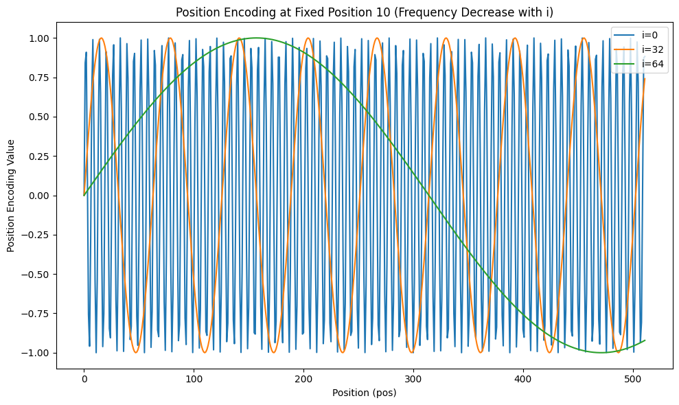

# 03-远古泉水绝对坐标的诅咒：原始 Transformer 位置编码与外推死穴

> **【召唤师峡谷全局战术简报】**  
> 自注意力机制（Self-Attention）天生是个“盲僧”——它具备置换不变性（Permutation Invariance）。如果不加干涉，英雄站在高地门牙塔、河道草丛还是敌方泉水，对它而言毫无区别！  
> 2017 年《Attention is All You Need》诞生之初，谷歌工程师为英雄们制作了第一代罗盘：**正余弦绝对位置编码（Sinusoidal Position Encoding）**。  
> 这套罗盘虽然不用花金币学习（零可训练参数），但其死板的“泉水绝对坐标”设计，在遇到超大地图长文本时，让英雄直接迷失在战争迷雾中！本篇为你彻底揭露这套古董罗盘的数学玄机与外推死穴。

---

## 一、Sinusoidal PE 是什么？远古泉水正余弦绝对经纬度

原始 Transformer 借助不同波长与频率的正弦波（$\sin$）与余弦波（$\cos$），为序列中第 $pos$ 个身位的英雄强行刻下绝对坐标标记：

$$
\text{PE}_{(pos, 2i)} = \sin\left(\frac{pos}{10000^{2i/d_{\text{model}}}}\right)
$$
$$
\text{PE}_{(pos, 2i+1)} = \cos\left(\frac{pos}{10000^{2i/d_{\text{model}}}}\right)
$$

### 【战场参数解密】
- `pos`：英雄在兵线上的绝对身位序号，从 0（第一个出泉水的小兵）一直排到 $seq\_len - 1$。
- `i`：英雄特征维度的平面索引（范围在 $0$ 到 $d_{\text{model}}/2 - 1$）。
- 偶数维度（$2i$）施加正弦波 $\sin$，奇数维度（$2i+1$）施加余弦波 $\cos$。
- 底数 $10000$：最大波长设定，相当于峡谷最边缘的最大可见视野周期。

---

## 二、战术实盘演练：第 2 个身位英雄的坐标演算

假设模型特征维度 $d_{\text{model}} = 8$，兵线长度 $seq\_len = 120$。现在我们要为站在第 2 个身位（`pos = 2`）的英雄打造专属位置装备：

### 1. 各维度波长缩放因子（div_term）
| 平面索引 $i$ | 对应特征维度 $(2i / 2i+1)$ | 缩放分母 $\text{div\_term}_i = 10000^{2i/d_{\text{model}}}$ |
|:---:|:---:|:---|
| 0 | 0（偶）/ 1（奇） | $10000^{0/8} = 1$ |
| 1 | 2（偶）/ 3（奇） | $10000^{2/8} = 10000^{0.25} \approx 10$ |
| 2 | 4（偶）/ 5（奇） | $10000^{4/8} = 10000^{0.5} = 100$ |
| 3 | 6（偶）/ 7（奇） | $10000^{6/8} = 10000^{0.75} \approx 1000$ |

### 2. 套入正余弦公式输出数值
$$
\begin{aligned}
\text{PE}(2, 0) &= \sin(2/1) = \sin(2.0) \approx 0.9093 \\
\text{PE}(2, 1) &= \cos(2/1) = \cos(2.0) \approx -0.4161 \\
\text{PE}(2, 2) &= \sin(2/10) = \sin(0.2) \approx 0.1987 \\
\text{PE}(2, 3) &= \cos(2/10) = \cos(0.2) \approx 0.9801 \\
\text{PE}(2, 4) &= \sin(2/100) = \sin(0.02) \approx 0.0200 \\
\text{PE}(2, 5) &= \cos(2/100) = \cos(0.02) \approx 0.9998 \\
\text{PE}(2, 6) &= \sin(2/1000) = \sin(0.002) \approx 0.0020 \\
\text{PE}(2, 7) &= \cos(2/1000) = \cos(0.002) \approx 0.9999 \\
\end{aligned}
$$

最终合成的第 2 身位坐标向量为：  
`[0.9093, -0.4161, 0.1987, 0.9801, 0.0200, 0.9998, 0.0020, 0.9999]`

---

## 三、PyTorch / NumPy 生产代码：正余弦位置编码器

```python
import numpy as np

def sinusoidal_position_encoding(seq_len, d_model):
    """
    计算远古正余弦绝对位置编码（Sinusoidal PE）。
    参数：
        seq_len -- 序列长度（当前兵线最大容量）
        d_model -- 模型的特征维度数
    返回：
        形状为 (seq_len, d_model) 的绝对坐标矩阵
    """
    # 1. 生成所有身位的绝对排位标号 [seq_len, 1]
    position = np.arange(seq_len)[:, np.newaxis]
    
    # 2. 生成各维度的指数波长分母 [d_model // 2]
    div_term = np.power(10000, (2 * (np.arange(d_model // 2)) / np.float32(d_model)))

    # 3. 构造输出网格并填充
    pe = np.zeros((seq_len, d_model))
    pe[:, 0::2] = np.sin(position / div_term)  # 偶数维度注入正弦脉冲
    pe[:, 1::2] = np.cos(position / div_term)  # 奇数维度注入余弦脉冲

    return pe

# 演习：生成 120 身位、8 维度的坐标矩阵
seq_len, d_model = 120, 8
pe = sinusoidal_position_encoding(seq_len, d_model)
print("位置编码矩阵形状：", pe.shape)  # (120, 8)
```

---

## 四、波形物理特性：低频慢动作与高频闪电击杀（远程衰减初显）

这套编码的一大妙处，在于它**无需消耗任何金币与梯度去训练（不可学习）**。  
观察其波长分母可以发现：
1. **低维度（$i$ 较小）**：分母小、频率高、周期极短，像刺客的超高攻速匕首，随着 `pos` 哪怕只移动 1 格，输出值也会剧烈震荡，专门捕捉**近身对线与相邻词的关系**。
2. **高维度（$i$ 较大）**：分母极大、频率极低、周期长如古树，随着 `pos` 移动，数值变化极度缓慢，专门提供**大局观视野与全图长程背景**。

### 【高维度迟钝性数学证明】
当 $d_{\text{model}} = 512, i = 256$ 时，分母为 $10000^1 = 10^4$。  
比较远处的两个相邻位置 $pos = 1000$ 与 $pos = 1001$：
$$
\Delta = \sin(10^{-4} \cdot 1001) - \sin(10^{-4} \cdot 1000) = \sin(0.1001) - \sin(0.1000) \approx 0.0000003
$$
差异仅仅在小数点后第七位！这意味着在深层长距离下，高维绝对坐标几乎处于静止麻木状态。

### 可视化波形代码演练：
```python
import numpy as np
import matplotlib.pyplot as plt

pe_plot = sinusoidal_position_encoding(seq_len=512, d_model=128)
plt.figure(figsize=(10, 5))
for i in [0, 32, 64]:
    plt.plot(np.arange(512), pe_plot[:, i], label=f'特征维度通道 i={i}')
plt.xlabel("英雄排位位置 (pos)")
plt.ylabel("坐标数值")
plt.title("正余弦位置编码不同维度的频率衰减趋势")
plt.legend()
plt.tight_layout()
# plt.show()
```



---

## 五、远古绝对编码的三大致命死穴（为什么逼得现代模型不得不换 RoPE？）

### 1. 死穴一：粗暴的向量加法（$x + PE$）污染了英雄技能本质！
在原始 Transformer 中，位置向量是直接与英雄词向量相加的：
$$
x_{\text{final}} = x_{\text{token}} + PE_{\text{pos}}
$$
随后在计算注意力点积时：
$$
Q K^T = (q + p_m)(k + p_n)^T = q k^T + q p_n^T + p_m k^T + p_m p_n^T
$$
**这导致了极其恶心的交叉项污染！** 英雄原本纯净的技能意图 $q$ 和 $k$，被迫和彼此的坐标 $p_m, p_n$ 强行纠缠相乘。模型必须耗费海量的前馈网络层，去痛苦地解耦“你到底是什么技能”和“你到底站在哪”。

### 2. 死穴二：只能报泉水绝对经纬度，不懂相对身位！
打团时，一个射手最关心的从来不是“自己距离天辉泉水有 8000 码”，而是**“对面的幽鬼刺客距离我只有 200 码（相对距离 $|m - n|$）”**！虽然正余弦在数学上能通过三角和差化积定理隐式体现线性变换，但在实际注意力权重中，模型极难直接感知到绝对距离差。

### 3. 死穴三：超大视野直接瞎眼（外推崩溃）！
这是最致命的痛点：如果在训练时，最长视野只见过 1024 码（Context Length = 1024）；实战中突然把模型丢进 4096 码甚至 32k 的超大视野地图中，**未见过的超大 `pos` 会让正余弦产生模型见所未见的外推高位震荡，输出一堆乱码胡话！**

---

## 结语：卡尔天火罗盘的登场前奏
正是为了彻底根除上述绝对坐标的诅咒，苏剑林等学者与现代大模型架构师推出了革命性的**旋转位置编码（RoPE）**——不加向量，改用复数旋转，直接在点积中天然内嵌相对距离衰减！下一章我们将全景拆解 RoPE 的神级操作！
