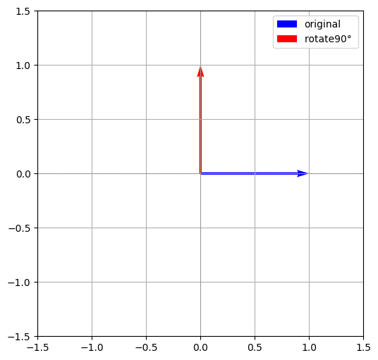

# 04-卡尔天火复数旋转罗盘：RoPE 旋转位置编码全解析

> **【召唤师峡谷全局战术简报】**  
> 远古 Transformer 的正余弦绝对坐标不仅容易被英雄攻击动作冲淡，而且遇到 32k 甚至 128k 超大地图视野时直接瞎眼外推暴毙。  
> 于是，苏剑林等顶尖架构师祭出了祈求者卡尔的压箱底绝技——**RoPE（Rotary Position Embedding，旋转位置编码）**！  
> RoPE 的精妙之处在于：**它不花一分钱买额外参数（零训练开销），也不在英雄身上强行捆绑绝对坐标包袱，而是将英雄的 Query（探云手）与 Key（接头暗号）打入复数欧拉旋转平面！**  
> 两个英雄计算注意力时，内积结果天然只取决于彼此的**【相对身位差 $(m - n)$】**，不仅自带随相对距离拉远而伤害衰减的物理直觉，更能平滑外推到全图超长距离！

---

## 一、温故知新：二维向量的逆时针旋转矩阵（卡尔天火罗盘校准）

在线性代数与召唤师物理学中，所谓对二维向量施加旋转，就是乘上一个正交旋转矩阵 $R(\theta)$：**只改变技能飞行朝向，绝不削减任何英雄技能原有的攻击力模长！**

给定平面二维技能向量：
$$
\mathbf{x} = \begin{bmatrix} x \\ y \end{bmatrix}
$$

让它在二维平面逆时针旋转 $\theta$ 弧度：
$$
\mathbf{x}_{\text{rot}} = R(\theta) \cdot \mathbf{x} = \begin{bmatrix} \cos \theta & -\sin \theta \\ \sin \theta & \cos \theta \end{bmatrix} \begin{bmatrix} x \\ y \end{bmatrix}
$$

### 【实战木桩演练】
若技能初始朝向 $\mathbf{x} = \begin{bmatrix} 1 \\ 0 \end{bmatrix}$（正东方向），逆时针旋转 $\theta = 90^\circ = \frac{\pi}{2}$：
$$
\mathbf{x}_{\text{rot}} = \begin{bmatrix} \cos \frac{\pi}{2} & -\sin \frac{\pi}{2} \\ \sin \frac{\pi}{2} & \cos \frac{\pi}{2} \end{bmatrix} \begin{bmatrix} 1 \\ 0 \end{bmatrix} = \begin{bmatrix} 0 & -1 \\ 1 & 0 \end{bmatrix} \begin{bmatrix} 1 \\ 0 \end{bmatrix} = \begin{bmatrix} 0 \\ 1 \end{bmatrix}
$$
技能飞行方向瞬间从 $(1, 0)$ 调转为正北 $(0, 1)$！

```python
import numpy as np
import matplotlib.pyplot as plt

def rotate_2d(x, y, theta_rad):
    R = np.array([
        [np.cos(theta_rad), -np.sin(theta_rad)],
        [np.sin(theta_rad),  np.cos(theta_rad)]
    ])
    return R @ np.array([x, y])

x1, y1 = rotate_2d(1, 0, np.deg2rad(90))
print(f"90° 旋转后坐标：({x1:.1f}, {y1:.1f})")  # (0.0, 1.0)
```



---

## 二、RoPE 核心破局：在注意力内积中注入相对距离函数

假设序列中有两个英雄，站在 $m$ 号身位的英雄打出 Query 向量 $q$，站在 $n$ 号身位的英雄亮出 Key 向量 $k$。

### 1. 分别给 Q 和 K 施加专属旋转
根据各自的站位序号 $m$ 和 $n$，施加各自的旋转角度 $\theta_q = m \cdot \omega$ 与 $\theta_k = n \cdot \omega$：
$$
\tilde{q} = R(m\omega) \cdot q, \quad \tilde{k} = R(n\omega) \cdot k
$$

### 2. 关键质变：内积自动涌现出相对身位 $(n - m)$！
当两个英雄进行注意力点积对接时：
$$
\tilde{q}^\top \tilde{k} = (R(m\omega) q)^\top (R(n\omega) k) = q^\top R(m\omega)^\top R(n\omega) k
$$

由于旋转矩阵是标准正交矩阵，$R(m\omega)^\top = R(-m\omega)$，两个旋转矩阵相乘就是角度相加减：
$$
R(-m\omega) R(n\omega) = R((n - m)\omega)
$$
因此：
$$
\tilde{q}^\top \tilde{k} = q^\top R((n - m)\omega) k
$$

> **【神级结论：绝对编码的形式，相对感知的灵魂】**  
> **注意看！绝对身位序号 $m$ 和 $n$ 在相乘的瞬间完全消失了，留下的唯有身位差 $(n - m)$！**  
> 哪怕把这两个英雄从一塔整体平移到二塔、高地塔，只要相对站位差 $(n - m)$ 不变，打出的注意力得分分毫不差！

```python
import numpy as np

q = np.array([1.0, 2.0])
k = np.array([3.0, 4.0])

# 假设身位差 n - m = 2 - 1 = 1，频率 ω = 1
theta = 1.0
R_relative = np.array([
    [np.cos(theta), -np.sin(theta)],
    [np.sin(theta),  np.cos(theta)],
])

att_score = q @ (R_relative @ k)
print("RoPE 相对注意力得分：", att_score)  # 7.62626733416533
```

---

## 三、推广至高维神装（$d_{\text{model}} \gg 2$）：两两结对旋转

实际大模型中，单个 Attention Head 的维度通常是 $d = 64$ 或 $128$。RoPE 的做法是：**将高维向量两两成对拆解为 $d/2$ 个独立的 2D 旋转平面！**

$$
\boldsymbol{R}_{\Theta,m}^{d} \boldsymbol{x} =
\begin{pmatrix}
\cos m\theta_0 & -\sin m\theta_0 & 0 & 0 & \cdots & 0 \\
\sin m\theta_0 & \cos m\theta_0 & 0 & 0 & \cdots & 0 \\
0 & 0 & \cos m\theta_1 & -\sin m\theta_1 & \cdots & 0 \\
0 & 0 & \sin m\theta_1 & \cos m\theta_1 & \cdots & 0 \\
\vdots & \vdots & \vdots & \vdots & \ddots & \vdots \\
0 & 0 & 0 & 0 & \cdots & \cos m\theta_{d/2-1}
\end{pmatrix}
\begin{pmatrix} 
x_0 \\ x_1 \\ x_2 \\ x_3 \\ \vdots \\ x_{d-1}
\end{pmatrix}
$$

### 【工程极速优化：稀疏矩阵相乘的向量化等价式】
上图的稀疏满矩阵如果真用矩阵乘法去跑，GPU 显存直接爆仓。在工程实战中，直接等价拆解为**逐元素点乘（Hadamard Product）与半翻转相加**：

$$
\boldsymbol{R}_{\Theta,m} \boldsymbol{x} = \boldsymbol{x} \odot \cos(m\Theta) + \tilde{\boldsymbol{x}} \odot \sin(m\Theta)
$$

其中 $\tilde{\boldsymbol{x}} = [-x_1, x_0, -x_3, x_2, \dots, -x_{d-1}, x_{d-2}]$。这一步计算速度直接翻了数十倍！

---

## 四、实操演练：$d_{\text{model}} = 4, \text{pos} = 2$ 手工验算与 PyTorch 核对

假设 Query 技能向量为 $\mathbf{q} = [1, 0, 0, 1]$，基底频率 $\omega = 10000$，$pos = 2$：

1. **计算各平面角频率**：
   $$\text{freqs} = \left[ \frac{1}{10000^{0/4}}, \frac{1}{10000^{2/4}} \right] = [1.0, 0.01]$$
   $$\text{angles} = 2 \times [1.0, 0.01] = [2.0, 0.02]$$
2. **第一对维度 $(1, 0)$ 旋转 $2.0$ 弧度**：
   $$[\cos(2), \sin(2)] \approx [-0.4161, 0.9093]$$
3. **第二对维度 $(0, 1)$ 旋转 $0.02$ 弧度**：
   $$[-\sin(0.02), \cos(0.02)] \approx [-0.0200, 0.9998]$$
4. **拼接四维输出**：
   $$\text{RoPE}(q) = [-0.4161, 0.9093, -0.0200, 0.9998]$$

---

## 五、工业级生产实战：LLaMA / MiniMind 级 RoPE 代码实现

在现代工业界（如 LLaMA、Mistral、MiniMind）中，为了最大化利用 PyTorch 底层 Tensor 连续显存，常采用**前半段与后半段半翻转（Rotate Half）**：

```python
import torch

def precompute_freqs_cis(d_model: int, end: int = int(32 * 1024), omiga: float = 1e6):
    """
    预计算整个赛季超长视野（32k）的 cos 与 sin 旋转罗盘缓存
    """
    # 1. 计算角频率列表 [d_model // 2]
    freqs = 1.0 / (omiga ** (torch.arange(0, d_model, 2)[: (d_model // 2)].float() / d_model))
    
    # 2. 生成所有身位索引 [end]
    t = torch.arange(end, device=freqs.device)
    
    # 3. 外积生成每个位置对应的弧度矩阵 [end, d_model // 2]
    freqs = torch.outer(t, freqs).float()
    
    # 4. 广播拼满整个 d_model 维度 [end, d_model]
    freqs_cos = torch.cat([torch.cos(freqs), torch.cos(freqs)], dim=-1)
    freqs_sin = torch.cat([torch.sin(freqs), torch.sin(freqs)], dim=-1)
    return freqs_cos, freqs_sin

def apply_rotary_pos_emb(q, k, cos, sin, position_ids=None, unsqueeze_dim=1):
    """
    将预计算好的卡尔复数旋转罗盘注入 Q 和 K 向量中
    """
    def rotate_half(x):
        # 将最后一维对半分开并交叉取负，完美等价于 2D 复数旋转！
        return torch.cat((-x[..., x.shape[-1] // 2:], x[..., : x.shape[-1] // 2]), dim=-1)

    # 利用广播机制极速逐元素相乘并求和
    cos = cos.unsqueeze(unsqueeze_dim)
    sin = sin.unsqueeze(unsqueeze_dim)
    
    q_embed = (q * cos) + (rotate_half(q) * sin)
    k_embed = (k * cos) + (rotate_half(k) * sin)
    return q_embed, k_embed

# ====== 实测演练 ======
d_model = 4
q = torch.tensor([1.0, 2.0, 3.0, 4.0])
k = torch.tensor([5.0, 6.0, 7.0, 8.0])

freqs_cos, freqs_sin = precompute_freqs_cis(d_model)
q_embed, k_embed = apply_rotary_pos_emb(q, k, freqs_cos, freqs_sin)
print("RoPE 输出张量形状：", q_embed.shape, k_embed.shape)
# 输出: torch.Size([32768, 1, 4]) torch.Size([32768, 1, 4])
```

> **【赛后战术总结】**  
> RoPE 用纯数学上的复数欧拉旋转，彻底拔除了绝对位置的死板枷锁！它不仅保持了向量模长不变，赋予了注意力机制天生的**相对身位衰减**先验，还为后续的 NTK-Aware、YaRN 等 128k 超大地图外推插值技术奠定了坚实地基！
