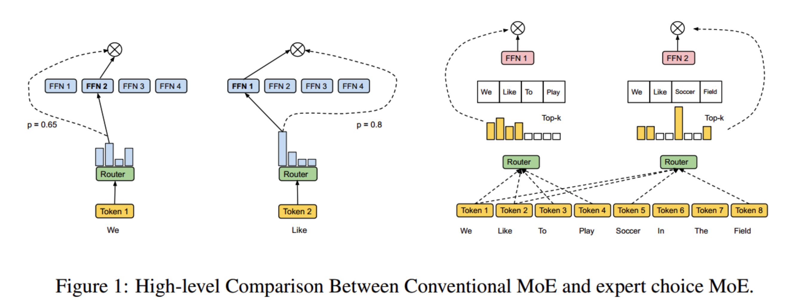

# 06-全明星战队轮换与替补席：专家混合模型 MoE 与门控路由

> **【召唤师峡谷全局战术简报】**  
> 传统的稠密大模型（Dense Model）就像一支死脑筋战队：无论是清一波小兵还是打远古肉山，全队 5 个英雄必须同时交出所有大招！算力消耗巨大，显卡直接冒烟。  
> 而 **MoE（Mixture of Experts，专家混合模型）** 带来了现代电子竞技的最高境界——**全明星替补席轮换制**！  
> 替补席上坐着 8 个、16 个甚至 64 个身怀绝技的专精打手（Expert FFN）。每当一个小兵（Token）进场，战队主教练 **MoE Gate（门控路由器）** 只需秒选出最契合战况的 **Top-k（通常是 Top-2）** 个打手登场输出，其余专家在替补席喝水观战！  
> 用百亿激活参数的计算代价，打出千亿总参数的统治级表现！本篇带你拆解门控前馈网络、Top-k 动态路由、推理批处理排序加速，以及防止明星选手过劳死的**辅助负载均衡损失（Auxiliary Loss）**！

---

## 一、稠密模型中的暴击引擎：带门控的前馈神经网络（Gated FFN）

在 Transformer 的标准残差块中，注意力机制负责“全场眼位侦查”，而紧随其后的 **前馈网络（FeedForward / FFN）** 才是真正的“伤害爆发核心”（占整机参数量的约 $\frac{2}{3}$）。

现代顶尖模型（LLaMA、Mistral、DeepSeek）早已废弃了原始的简单两层线性变换，全员列装了**带门控机制的 SwiGLU / Gated FFN**：

| 特性维度 | 远古经典标准 FFN | 现代门控增强版 FFN（Gated FFN） |
|:---|:---|:---|
| **核心机制** | 单路线性升维 $\to$ 激活 $\to$ 降维 | **双路并行计算（阀门控制 $\times$ 技能威力）** |
| **激活函数** | 僵硬的 ReLU 或 GELU | 平滑的 SiLU / Swish（梯度不饱和） |
| **参数量** | 2 个线性投影层 | 3 个线性投影层（`gate_proj`, `up_proj`, `down_proj`） |
| **非线性爆发力** | 一般（基础平A） | **极高（乘法门控动态调节信息流流通量）** |

```python
import torch
import torch.nn as nn
import torch.nn.functional as F

ACT2FN = {"relu": F.relu, "gelu": F.gelu, "silu": F.silu}

class FeedForward(nn.Module):
    def __init__(self, config: dict):
        super().__init__()
        # 自动计算中间隐藏层维度（通常为 hidden_size 的 8/3 倍，并强制向 64 字节对齐，迎合 GPU TensorCore 吞吐）
        if config["intermediate_size"] is None:
            intermediate_size = int(config["hidden_size"] * 8 / 3)
            config["intermediate_size"] = 64 * ((intermediate_size + 64 - 1) // 64)

        # 1. 门控投影：生成 [0, 1] 附近的动态能量阀门
        self.gate_proj = nn.Linear(config["hidden_size"], config["intermediate_size"], bias=False)
        # 2. 升维投影：技能伤害载荷通道
        self.up_proj = nn.Linear(config["hidden_size"], config["intermediate_size"], bias=False)
        # 3. 降维投影：汇聚爆发输出，还原维度
        self.down_proj = nn.Linear(config["intermediate_size"], config["hidden_size"], bias=False)
        
        self.dropout = nn.Dropout(config["dropout"])
        self.act_fn = ACT2FN[config["hidden_act"]]

    def forward(self, x):
        # 核心连招：gate 阀门激活后，与 up 载荷逐元素相乘，再由 down 投影还原！
        return self.dropout(
            self.down_proj(self.act_fn(self.gate_proj(x)) * self.up_proj(x))
        )
```

---

## 二、稀疏 MoE 的战术革命：打手轮换与协同输出

### 1. MoE 的运作四步走
1. **教练打分**：每个 Token 经过 `MoEGate` 门控线性层打分，经过 Softmax 得到全队专家的胜率预测。
2. **遴选 Top-k**：选出得分最高的 $k$ 个专家（如 $k=2$）。
3. **分流出战**：该 Token 只被这 2 个专家处理，其余专家完全不消耗 FLOPs 计算！
4. **加权终结**：将这 2 个专家的输出，按照门控打分的权重进行加权累加！

```
                      [输入 Token 特征 x]
                              │
               ┌──────────────┴──────────────┐
               ▼                             ▼
       【常驻老队长 (Shared)】       【战术教练 (MoEGate)】
               │                             │ 打分选出 Top-2
               │                   ┌─────────┴─────────┐
               │                   ▼                   ▼
               │              [专家 2 (法伤)]     [专家 5 (物理)]
               │                   │                   │
               │                   └─────────┬─────────┘
               │                             │ (加权求和)
               └──────────────┬──────────────┘
                              ▼
                        [最终输出特征 y]
```

---

## 三、PyTorch 源码拆解：MiniMind MoE 模块（训练 vs 推理双模态设计）

在实际工程中，**训练阶段**为了反向传播求导方便，通常将 Token 复制 $k$ 份；而在**在线推理阶段**，为了追求极限吞吐，必须采用**专家桶排序（Bucket Sorting）与 `scatter_add_` 聚合**！

```python
class MOEFeedForward(nn.Module):
    def __init__(self, config):
        super().__init__()
        self.config = config

        # 1. 注册候补席专精打手列表
        self.experts = nn.ModuleList([
            FeedForward(config) for _ in range(config.n_routed_experts)
        ])

        # 2. 招募战术门控主教练
        self.gate = MoEGate(config)

        # 3. 常驻全能老队长（DeepSeek 架构精髓：兜底常识，人人受益）
        if config.n_shared_experts > 0:
            self.shared_experts = nn.ModuleList([
                FeedForward(config) for _ in range(config.n_shared_experts)
            ])

    def forward(self, x):
        identity = x
        orig_shape = x.shape
        bsz, seq_len, _ = x.shape

        # Step 1: 教练打分，选拔 Top-k 打手
        topk_idx, topk_weight, aux_loss = self.gate(x)
        # topk_idx: [bsz * seq_len, top_k], topk_weight: [bsz * seq_len, top_k]

        x_flat = x.view(-1, x.shape[-1])
        flat_topk_idx = topk_idx.view(-1)

        if self.training:
            # ===== 训练模式：Token 复制 top_k 次，分别送入专家求梯度 =====
            x_rep = x_flat.repeat_interleave(self.config.num_experts_per_tok, dim=0)
            y = torch.empty_like(x_rep, dtype=torch.float16)

            for i, expert in enumerate(self.experts):
                mask = (flat_topk_idx == i)
                if mask.any():
                    y[mask] = expert(x_rep[mask]).to(y.dtype)

            # 按教练权重加权求和并还原形状
            y = y.view(*topk_weight.shape, -1)
            y = (y * topk_weight.unsqueeze(-1)).sum(dim=1).view(*orig_shape)

        else:
            # ===== 推理模式：专家分组批量计算，零内存冗余复制 =====
            topk_weight_flat = topk_weight.view(-1, 1)
            y = self.moe_infer(x_flat, flat_topk_idx, topk_weight_flat).view(*orig_shape)

        # Step 2: 叠加常驻老队长的稳定输出
        if self.config.n_shared_experts > 0:
            for expert in self.shared_experts:
                y = y + expert(identity)

        self.aux_loss = aux_loss
        return y

    @torch.no_grad()
    def moe_infer(self, x, flat_expert_indices, flat_expert_weights):
        """
        【极致推理流】：按专家 ID 排序，连续切片送入对应专家，scatter_add_ 累加
        """
        expert_cache = torch.zeros_like(x)

        # 1. 对分配记录按专家编号进行升序快排
        idxs = flat_expert_indices.argsort()

        # 2. 前缀和统计每个专家的分派区间
        tokens_per_expert = flat_expert_indices.bincount(minlength=len(self.experts)).cpu().numpy().cumsum(0)

        # 3. 还原属于哪个原始 Token
        token_idxs = idxs // self.config.num_experts_per_tok

        for i, end_idx in enumerate(tokens_per_expert):
            start_idx = 0 if i == 0 else tokens_per_expert[i - 1]
            if start_idx == end_idx:
                continue  # 该专家本轮坐冷板凳，跳过

            # 提取分配给第 i 个专家的所有原始 Token
            exp_token_idx = token_idxs[start_idx:end_idx]
            expert_tokens = x[exp_token_idx]

            # 专家执行前向推导并施加权重
            expert_out = self.experts[i](expert_tokens).to(expert_cache.dtype)
            expert_out.mul_(flat_expert_weights[idxs[start_idx:end_idx]])

            # 极速散射累加回总缓存
            expert_cache.scatter_add_(
                dim=0,
                index=exp_token_idx.view(-1, 1).repeat(1, x.shape[-1]),
                src=expert_out
            )

        return expert_cache
```

---

## 四、防御路由坍塌：辅助损失（Auxiliary Loss）防止明星选手过劳死

在没有任何约束的情况下，门控网络极其容易产生**“马太效应 / 路由坍塌（Route Collapse）”**：
- 教练在初期偶然发现专家 0 表现不错，就会不断给专家 0 打高分；
- 专家 0 接收到 90% 的 Token，梯度疯狂更新，越来越强；
- 其余专家 1~7 全程坐冷板凳，梯度停止流动，彻底沦为僵尸参数！
- **恶果**：专家 0 显存过载暴毙，整个网络退化为一个营养不良的小稠密模型！



### 【破局利刃：负载均衡惩罚项】
在损失函数中增加一项专门监督教练的罚款项：
$$
L_{\text{aux}} = \alpha \cdot E \sum_{i=1}^{E} P_i \cdot f_i
$$
- $P_i$：教练对专家 $i$ 的**平均打分（倾向概率）**。
- $f_i$：分配给专家 $i$ 的**实际 Token 负载比例**。
- **数学惩罚机理**：当且仅当所有专家的 $P_i$ 和 $f_i$ 均等分布时，柯西-施瓦茨不等式下该式取得极小值！一旦某个明星专家的打分又高、上场频率又极高，其乘积项会瞬间暴涨，直接在反向传播中重罚门控网络，强迫教练**“雨露均沾、全员轮换”**！

```python
class MoEGate(nn.Module):
    def __init__(self, config):
        super().__init__()
        self.top_k = config.num_experts_per_tok
        self.n_routed_experts = config.n_routed_experts
        self.alpha = config.aux_loss_alpha
        self.weight = nn.Parameter(torch.empty((self.n_routed_experts, config.hidden_size)))
        nn.init.kaiming_uniform_(self.weight, a=math.sqrt(5))

    def forward(self, hidden_states):
        bsz, seq_len, h = hidden_states.shape
        hidden_states = hidden_states.view(-1, h)

        # 1. 战术打分
        logits = F.linear(hidden_states, self.weight, None)
        scores = logits.softmax(dim=-1)

        # 2. 遴选 Top-k
        topk_weight, topk_idx = torch.topk(scores, k=self.top_k, dim=-1, sorted=False)
        topk_weight = topk_weight / (topk_weight.sum(dim=-1, keepdim=True) + 1e-20)

        # 3. 计算辅助平衡损失
        if self.training and self.alpha > 0.0:
            # 统计实际被选中的频次
            mask_ce = F.one_hot(topk_idx.view(-1), num_classes=self.n_routed_experts).float()
            ce = mask_ce.mean(0)               # 各专家实际出场频率
            Pi = scores.mean(0)                # 各专家理论预测打分
            fi = ce * self.n_routed_experts    # 负载比率
            aux_loss = (Pi * fi).sum() * self.alpha  # 乘积惩罚
        else:
            aux_loss = 0.0

        return topk_idx, topk_weight, aux_loss
```

> **【赛后战术总结】**  
> MoE 是大模型突破规模极限的杀手锏！通过**“动态门控 + Top-k 激活 + 共享老队长兜底 + 辅助损失防过载”**的四合一组合拳，它实现了算力与容量的完美解耦，成就了当今天梯榜上各路顶尖开源 MoE 神作！
