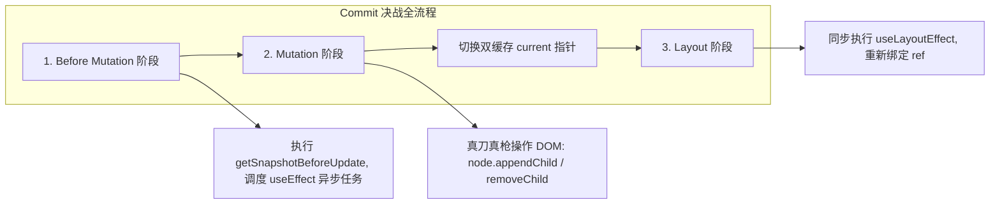

# 刀塔/王者/LOL 英雄联盟决战召唤师峡谷：React 源码终极通关秘籍

> 凡人读 React 源码：Fiber、Reconciler、Lanes、双缓存、Hooks 单向链表……枯燥欲睡。  
> 顶级电竞选手读 React 源码：**这就是一场 60 帧绝地求生、走 A 拉扯、买活换位、五杀团战的召唤师峡谷电竞赛事！**  
> 本笔记将 `study/react-code` 的全部 36 篇核心知识点，全景翻译为 **MOBA（英雄联盟 / DOTA2）竞技体系**，让你在打团的快感中把 React 18 的底层原理骨髓彻底吃透。

---

## 英雄战术地图（知识点速查）
- [第一回：终极战术目标 —— 团战决不能掉帧（React 理念与 60FPS 瓶颈）](#第一回终极战术目标--团战决不能掉帧react-理念与-60fps-瓶颈)
- [第二回：站桩读条的惨剧 —— 为什么老架构（Stack Reconciler）必须死？](#第二回站桩读条的惨剧--为什么老架构stack-reconciler必须死)
- [第三回：神装登场 —— Fiber 架构的心智模型与双缓存“买活镜像”](#第三回神装登场--fiber-架构的心智模型与双缓存买活镜像)
- [第四回：战队战术指挥链 —— Fiber 树的指针网（child / sibling / return）](#第四回战队战术指挥链--fiber-树的指针网child--sibling--return)
- [第五回：微操走 A 与时间切片 —— 5ms 走一步，普攻绝不卡平 A](#第五回微操走-a-与时间切片--5ms-走一步普攻绝不卡平-a)
- [第六回：战略战备处 —— Scheduler（调度器）与小顶堆冷却计时器](#第六回战略战备处--scheduler调度器与小顶堆冷却计时器)
- [第七回：全图 31 条兵线优先级 —— Lane（车道）模型的位运算战法](#第七回全图-31-条兵线优先级--lane车道模型的位运算战法)
- [第八回：前线侦察与打扫战场 —— Render 阶段的 beginWork 与 completeWork](#第八回前线侦察与打扫战场--render-阶段的-beginwork-与-completework)
- [第九回：对线单挑与团战换人 —— 极度苛刻的 Diff 算法对决](#第九回对线单挑与团战换人--极度苛刻的-diff-算法对决)
- [第十回：推平基地水晶 —— Commit 阶段三大子战役（Before Mutation / Mutation / Layout）](#第十回推平基地水晶--commit-阶段三大子战役before-mutation--mutation--layout)
- [第十一回：英雄技能装备栏 —— 为什么 Hooks 是单向链表？严禁在 if 中施法！](#第十一回英雄技能装备栏--为什么-hooks-是单向链表严禁在-if-中施法)
- [第十二回：核心技能大招鉴赏 —— useState、useEffect、useRef、useMemo 底层大揭秘](#第十二回核心技能大招鉴赏--usestateuseeffectuserefusememo-底层大揭秘)

---

## 第一回：终极战术目标 —— 团战决不能掉帧（React 理念与 60FPS 瓶颈）

在电竞赛事中，最致命的不是被对面单杀，而是**团战突然掉到 10 帧，屏幕直接卡死成幻灯片**。

- **显示器刷新率（比赛规则）**：普通显示器 60Hz 刷新，即 **16.6ms（1000ms / 60）** 必须刷新一帧画面。
- **这 16.6ms 浏览器要做什么？**
  1. 响应用户操作（按 QWER 技能、鼠标右键走位）；
  2. 执行 JavaScript 脚本；
  3. 计算样式（Recalculate Style）；
  4. 布局（Layout 重排）；
  5. 绘制（Paint 重绘）。
- **两大致命团战瓶颈**：
  1. **CPU 瓶颈**：前线爆发 5v5 大团战，满屏技能特效（DOM 节点上千个），JS 计算执行了 50ms。浏览器直接跳过两帧，玩家狂按“闪现/BKB”毫无反应，当场摔键盘。
  2. **I/O 瓶颈**：等网络回包（如查大龙血量、装备数据），界面直接卡死发呆。

**React 战队的唯一建军理念：【快速响应】—— 无论前线技能多炸裂，玩家的键盘走位响应绝不能慢！**

---

## 第二回：站桩读条的惨剧 —— 为什么老架构（Stack Reconciler）必须死？

在 React 15 及以前，架构叫 **Stack Reconciler（基于函数调用栈的协调器）**。

### 英雄死因：巫妖王/马尔扎哈的“原地站桩大招”
- **工作机制**：组件更新时，老 React 用深度优先遍历递归比对整棵树。
- **致命机制**：**JavaScript 的函数调用栈一旦开始递归，就无法在中途被暂停！**
  就像英雄按下了不能打断的 3 秒原地读条引导大招。哪怕此时对面刺客（用户的鼠标点击、键盘输入）已经贴脸，由于主线程正被死死咬在调用栈深处，浏览器根本无法腾出手去响应点击。
- **战术结论**：老架构不可中断，必须彻底推翻，重做英雄机制！

---

## 第三回：神装登场 —— Fiber 架构的心智模型与双缓存“买活镜像”

React 16 全面重做，祭出了划时代的 **Fiber 架构**。

### 1. 什么是 Fiber？（操作系统的微型协程）
在 JavaScript 单线程这个战场里，React 自己实现了一个**带有时间记忆的召唤物（Fiber 节点）**。它将原来一个不可分割的大型递归更新，拆解成一个个极其微小的“补刀小任务”。每个 Fiber 节点代表一个英雄（组件/DOM 元素）。

### 2. 双缓存机制（Double Buffering）—— 泉水买活与替身镜像！
在 DOTA2 中，英雄阵亡可以“买活”；在 LOL 中，妖姬可以制造替身假人。

```
【大屏幕当前展示的真身战场】
RootFiber ──► current 树 (代表当前屏幕上已经画出来的真实 DOM)
                 ▲
                 │ (workInProgress.alternate 指针互相牵制)
                 ▼
【泉水暗地里正在施法合成的替身】
RootFiber ──► workInProgress 树 (内存中悄悄计算比对的新草稿)
```

- **第一阶段（暗度陈仓）**：所有状态变更、DOM 属性比对、计算工作，**全部在背地的 `workInProgress`（替身）树上进行**。真身 `current` 树依然稳稳在屏幕上渲染，绝不影响玩家视角。
- **第二阶段（瞬间换位）**：当内存里的 `workInProgress` 树全部算完、DOM 节点准备就绪，React 只需要**一瞬间把指针指向切换过去**：
  ```ts
  root.current = workInProgress;
  ```
  替身瞬间变真身，丝滑上线！没有任何撕裂、白屏或中间半成品闪烁。

---

## 第四回：战队战术指挥链 —— Fiber 树的指针网（child / sibling / return）

传统的 DOM 树只有 `children` 数组，为什么 Fiber 节点要改成复杂的链表指针？

```ts
function FiberNode() {
  this.tag = WorkTag;        // 英雄定位（函数组件、类组件、原生宿主 DOM）
  this.key = Key;            // 英雄唯一身份证

  // === 核心铁三角战术链条 ===
  this.child = Fiber;        // 大儿子（直属先锋兵）
  this.sibling = Fiber;      // 亲兄弟（并肩作战的队友）
  this.return = Fiber;       // 父节点（打完收工向大本营汇报）

  // === 状态与副作用 ===
  this.pendingProps = any;   // 新领取的战术指令
  this.memoizedState = any;  // 当前身上的状态/装备 (Hooks 链表挂在这里！)
  this.flags = Flags;        // 身上打的行动标记 (击杀/放置/更新)
  this.alternate = Fiber;    // 指向另一个位面的替身镜像 (双缓存指针)
}
```

```
           [ App 基地 ]
                │ (child)
                ▼
          [ Header 队长 ] ──(sibling)──► [ Main 突击手 ]
                │                              │
             (return)                       (return)
                └──────────────┬───────────────┘
                               ▼
                          [ App 基地 ]
```

**为什么设计成单向链表？**
> **因为链表随时可以按暂停键！**
> 递归调用栈无法记录“执行到哪一行了”，而链表只需把当前停下的 Fiber 节点保存在全局变量 `workInProgress` 中。随时暂停、随时去处理急诊高优任务，回过头来顺着 `sibling` 或 `return` 指针就能**无缝恢复施法现场**！

---

## 第五回：微操走 A 与时间切片 —— 5ms 走一步，普攻绝不卡平 A

电竞高手对线最强基本功是什么？**走 A（Hit & Run）！**
每一次普攻打出伤害（前摇结束），立刻右键点地板取消后摇走位，绝不站在原地当靶子。

### React 的【走 A 循环】：`workLoopConcurrent`
```ts
function workLoopConcurrent() {
  // 只要还有小兵没补完，并且当前帧还没超时，就继续打！
  while (workInProgress !== null && !shouldYield()) {
    performUnitOfWork(workInProgress);
  }
}
```

1. **普攻一刀（处理一个 Fiber 节点）**：调用 `performUnitOfWork`，大约消耗几十微秒。
2. **走位判定（`shouldYield()`）**：
   React 向浏览器申请时间片（默认约 **5ms**）。
   每次补完一个 Fiber 兵，React 瞄一眼系统时钟：
   - 如果 5ms 还没用完 $\rightarrow$ 继续普攻下一个 Fiber！
   - 如果 5ms 时间到了 $\rightarrow$ **立刻打断施法，把主线程控制权交还给浏览器**：“浏览器大哥，你先处理玩家鼠标点击和 60 帧绘制，我不占着键盘！”
3. **下次回头接着打**：浏览器处理完点击事件，Scheduler（调度器）在下一个空闲微时间片内精准叫醒 React，继续刚才停下的那个 Fiber 往下补刀。

**结果**：即使组件树有 50,000 个节点，页面再也不会卡死，玩家操作如丝般顺滑！

---

## 第六回：战略战备处 —— Scheduler（调度器）与小顶堆冷却计时器

浏览器原本有一个 `requestIdleCallback`，但 React 弃用了它，因为各浏览器实现参差不齐且刷新率不可控。React 自己打造了一套**独立战备指挥中心 —— Scheduler**。

### 1. 战备指挥官的小顶堆（Min-Heap）
在后台，指挥官维护了两个基于最小二叉堆（Min-Heap）的优先级军团：
- **`timerQueue`（未冷却战备区）**：任务还没到生效时间（比如 `setTimeout` 延迟任务），按开始时间排序。
- **`taskQueue`（随时待命出征区）**：已经冷却完毕、随时可进场的任务，**按过期时间（`expirationTime`）越早越紧急排序**。

### 2. 任务过期直接“死刑通牒”
当一个普通任务在队列里拖延太久，它的过期时间一旦到达当前物理时间，Scheduler 会直接给它套上**最高紧急状态（Expired）**，不再允许任何时间切片走 A，强制**同步打出，必须立刻上屏**！

---

## 第七回：全图 31 条兵线优先级 —— Lane（车道）模型的位运算战法

React 16 早期用的是粗糙的 `ExpirationTime`，到了 React 17/18，全面升级为神级 **Lane（赛车道/兵线）模型**。

### 1. 31 位的二进制战法
在 [lane模型.md](file:///Users/huangjun/Documents/study/react-code/lane%E6%A8%A1%E5%9E%8B.md) 中，React 用一个 31 位的整型数字表示 31 条兵线：

```ts
export const SyncLane: Lane =               0b0000000000000000000000000000001; // 极高危：保命闪现/BKB（用户文本输入）
export const InputContinuousLane: Lane =     0b0000000000000000000000000001000; // 高危：鼠标滚轮拖拽
export const DefaultLane: Lane =             0b0000000000000000000100000000000; // 普通：普通平 A 补刀（接口数据返回）
export const TransitionLane: Lane =          0b0000000001000000000000000000000; // 低危：打野清野区（Tab 切换大视图）
export const IdleLane: Lane =                0b0100000000000000000000000000000; // 最低：挂机清线
```

### 2. 为什么是位运算？（极致团战战术调度）
- **判定是否包含某战术（按位与 `&`）**：
  `if (actionLanes & SyncLane)`
- **合并多路兵线一起进军（按位或 `|`）**：
  `renderLanes = SyncLane | InputContinuousLane;`
- **找出当前最紧急的带头大哥（lowbit 算法）**：
  ```ts
  function getHighestPriorityLane(lanes) {
    return lanes & -lanes; // 单条汇编级 CPU 指令，瞬间提取最右侧第一个 1！
  }
  ```

### 3. 团战插队与重开（Interruption）
假设当前正在渲染低优先级的打野任务 `TransitionLane`（算到第 50%）：
突然玩家狂点键盘触发了 `SyncLane`（闪现）：
1. 调度官立刻向当前战场大喊：“**停下！先别算了！**”
2. 刚才算了一半的临时草稿直接作废（或靠边暂存）；
3. 腾出全部算力，零延迟完成 `SyncLane` 闪现上屏；
4. 闪现上屏后，再重新拉起刚才被打断的 `TransitionLane` 任务继续干！

---

## 第八回：前线侦察与打扫战场 —— Render 阶段的 beginWork 与 completeWork

整个 React 工作流程由两大阶段组成：
1. **Render 阶段（暗度陈仓，在内存中计算，可中断）**
2. **Commit 阶段（真刀真枪切入，不可中断）**

Render 阶段的核心，就是经典的**“深度优先遍历大迂回”**：

```
                beginWork (向下突进侦察)
                   │
                   ▼
               [ Root 基地 ]
              /             \
      [ Comp 英雄 A ]    [ Comp 英雄 B ]
             │                  │
             ▼                  ▼
     [ DOM 节点 A1 ]     [ DOM 节点 B1 ]
                   ▲
                   │
               completeWork (自底向上打扫归来)
```

### 1. `beginWork`（自顶向下突进侦察）：
- 检查当前 Fiber 是否可以被复用（Memo 拦截）；
- 执行函数组件的 `render` 或类组件的 `render()`，算出新的 `children`；
- 进入著名的 **Diff 算法**，比对新老子节点，给 Fiber 打上战术标签（`Flags`）：
  - `Placement`（新英雄入场，需要插入 DOM）
  - `Update`（英雄换装，需要更新属性）
  - `Deletion`（英雄阵亡，需要从 DOM 拔除）

### 2. `completeWork`（自底向上打扫收官）：
当侦察到底部叶子节点（无法继续 `beginWork`），开始掉头向上归纳：
- 为原生 DOM 节点创建真实 DOM 实例（`createInstance`）；
- 初始化真实 DOM 的属性，绑定事件监听；
- **最关键的战利品冒泡（`bubbleProperties`）**：
  每个子节点把自己身上的 `flags` 向上交接合并到父节点的 `subtreeFlags` 中。
  这样当退回顶层 `Root` 基地时，**基地一眼就能知道整张地图到底存不存在任何 DOM 修改，完全不需要再递归一遍！**

---

## 第九回：对线单挑与团战换人 —— 极度苛刻的 Diff 算法对决

传统树 Diff 算法时间复杂度是恐怖的 $O(n^3)$。React 为保证 60 帧不卡，立下了**三条战术军规**，将复杂度强行压到 $O(n)$：
1. **不同营阵不比对**：如果父节点的 DOM 标签从 `<div>` 变成 `<p>`，直接整棵树推倒重建，子节点不再浪费时间比对。
2. **身份证认人（Key）**：同一层级的子节点，依靠唯一 `key` 判定是否为同一个英雄。
3. **只打同级对线**：绝不跨层级比对。

### 团战换位：多节点 Diff 的两轮冲锋战

面对一组列表，例如从 `[A, B, C, D]` 变成 `[A, C, B, E]`：

#### 第一轮冲锋：快速对线检查
从左往右，如果 `key` 和 `type` 一模一样，说明是老英雄换装，直接复用。遇到第一个对不上的（`B` 和 `C` 冲突），**立即跳出第一轮冲锋！**

#### 第二轮冲锋：乱序定位与跳斩
1. 将剩下的老英雄们塞进一个快速查找字典：`existingChildren = Map(key -> Fiber)`。
2. 维护一个在老队伍中出现过的最靠右的位置指针：`lastPlacedIndex`。
3. 遍历新队伍：
   - 如果新英雄在 Map 里能找到：
     - 如果他在老队伍中的位置 $\ge lastPlacedIndex$：说明他相对靠后，**不需要移动**，将 `lastPlacedIndex` 刷新为他的老位置；
     - 如果他在老队伍中的位置 $< lastPlacedIndex$：**说明他跑到前面去了，被抓包！打上 `Placement` 标记，必须在真实 DOM 移动！**
   - 如果新英雄在 Map 里找不到：打上 `Placement` 纯新建标记！
4. 最后 Map 里剩下的老英雄，全部打上 `Deletion` 阵亡标记！

---

## 第十回：推平基地水晶 —— Commit 阶段三大子战役

一旦 Render 阶段在内存里把 DOM 树和操作标记全部敲定，比赛进入不可中断的 **Commit 阶段**。此时全军出击，谁按暂停键都不好使！



### 第一战役：Before Mutation（战前侦察）
- 执行类组件的 `getSnapshotBeforeUpdate`（截取更新前滚动条位置等快照）；
- 调度异步的 `useEffect`（准备在打完团后的空闲时间执行）。

### 第二战役：Mutation（刺刀见红，真实 DOM 变动）
- 按照 Fiber 上的 `flags`，真正调用原生 DOM API 执行 `appendChild`、`insertBefore`、`removeChild`。
- 清理解绑旧的 `ref`。
- **就在战役结束的一瞬间，React 瞬间切换全局指针**：
  ```ts
  root.current = finishedWork; // 替身瞬间变成统治屏幕的真身！
  ```

### 第三战役：Layout（战后盘点与整顿）
- 此时屏幕上的真实 DOM 已经全部就位！
- **同步执行 `useLayoutEffect` 回调**：
  > 为什么在这执行？因为此时 DOM 已经在内存中摆好，但浏览器**还没有进行 Paint 绘制**！你可以在这里测量 DOM 宽高并二次微调，页面绝不会发生闪烁。
- 绑定新的 `ref` 引用。

---

## 第十一回：英雄技能装备栏 —— 为什么 Hooks 是单向链表？

进入函数组件内部，Hooks 是最神奇的存在。为什么官方军规**严禁在 `if / else` 或者循环里调用 Hook？**

### 底层装备栏结构：Hook 单向链表！
每个函数组件的 Fiber 节点上，都有一个 `memoizedState` 属性。这个属性不是存普通的数字，而是一条**单向链表**：

```ts
function Hook() {
  this.memoizedState = any;     // 存储具体的技能数据 (count、state)
  this.baseState = any;         // 基础状态
  this.baseQueue = Update;      // 基础更新队列
  this.queue = UpdateQueue;     // 待执行的施法更新环状链表
  this.next = Hook;             // 指向装备栏的下一个装备槽位！
}
```

```
Fiber.memoizedState
       │
       ▼
[ Hook 1: useState(count) ] ──next──► [ Hook 2: useEffect ] ──next──► [ Hook 3: useRef ]
```

### 为什么在 `if` 语句里写 Hook 会导致毁灭性团灭？
React 在执行函数组件时，靠的是一个全局游标 `workInProgressHook`。
- 首次渲染（Mount）：创建 Hook 1 $\rightarrow$ Hook 2 $\rightarrow$ Hook 3。
- 更新渲染（Update）：**React 根本不知道你变量名叫什么！它只认顺序：**
  第 1 次调 `useState`，就把游标指向链表第 1 个节点；
  第 2 次调 `useEffect`，就把游标指向第 2 个节点。

如果你在中间加了一个 `if (isFullBlood)` 跳过了第 1 个 Hook：
> **游标立刻错位！把原本属于 `useEffect` 的数据，强行当成了 `useState` 的数据喂给了组件！整个技能栏全面窜位，直接引发系统崩溃抛错！**

---

## 第十二回：核心技能大招鉴赏 —— 底层大揭秘

### 1. `useState` 与 `useReducer`（技能状态机）
- 底层其实是同一种东西，`useState` 就是一个内置了预设 Reducer 的 `useReducer`。
- 当你调用 `setCount(c => c + 1)` 时，并不会立即修改数值，而是向该 Hook 的 `queue` 中追加一个 `Update` 对象。
- **环状单向链表（Circular Linked List）**：更新队列被设计成首尾相连的环状链表，方便在常数时间 $O(1)$ 快速拿到队列的头部和尾部。

### 2. `useEffect` vs `useLayoutEffect`（施法前摇与回城特效）
- **`useLayoutEffect`（原地瞬发闪现）**：
  在 Commit 的 Layout 阶段**同步执行**。它会阻塞浏览器的实际绘制，适合测量 DOM、同步纠正动画，绝不闪烁。
- **`useEffect`（回城安全结算）**：
  在 Commit 阶段仅做登记，等浏览器真正把像素画到屏幕上、主线程空闲下来后，通过 `MessageChannel` / 宏微任务调度**异步执行**，绝不拖慢首屏渲染帧率！

### 3. `useRef`（英雄贴身不可掉落的私人物品）
- `useRef(initialValue)` 底层极简：
  ```ts
  function mountRef(initialValue) {
    const hook = mountWorkInProgressHook();
    const ref = { current: initialValue }; // 仅仅在堆内存中包装了一个对象壳子！
    hook.memoizedState = ref;
    return ref;
  }
  ```
  在后续所有更新阶段，直接返回该对象的同一个堆内存指针引用。无论组件重新执行一万次，`ref.current` 永远是那个稳定的指针。

### 4. `useMemo` 与 `useCallback`（战术缓存符）
- **`useMemo`**：把计算结果存入 `hook.memoizedState = [value, deps]`。更新时比对 `deps` 数组（通过 `Object.is`），如果数组没变，直接返回上次存的 `value`。
- **`useCallback`**：把函数本身存入 `hook.memoizedState = [callback, deps]`，同样通过依赖项比对，避免每次重渲染产出新的函数内存地址。

---

## 终局复盘：召唤师峡谷总战报速查

| React 概念 | 召唤师峡谷（MOBA）战术映射 | 战术核心目的 |
| :--- | :--- | :--- |
| **浏览器 16.6ms 限制** | 比赛 60FPS 锁帧红线 | 任何逻辑超过这个时限都会导致团战卡成幻灯片 |
| **老 Stack 架构** | 无法中断的原地引导大招（站桩读条） | 递归无法暂停，用户操作被活活卡死在调用栈深处 |
| **Fiber 双缓存树** | 真身战场 (`current`) 与泉水替身 (`workInProgress`) | 所有复杂运算在背地替身上进行，上屏一瞬间换位指针，告别白屏撕裂 |
| **时间切片 (Time Slicing)** | 普攻走砍（走 A / Hit & Run 机制） | 每补刀 5ms 必须停手位移一次，优先把控制权还给浏览器处理走位点击 |
| **Lane 赛道模型** | 31 条兵线优先级与 BKB 紧急闪现令 | 用位运算与 lowbit 算法瞬间决策出最高危急任务，随时支持团战插队与重开 |
| **Render 阶段** | 前线侦察与标记战利品（可打断） | `beginWork`（打 Flags）+ `completeWork`（自底向上冒泡战果） |
| **Diff 算法** | 严格按照 Key 身份证同级换人对位 | 将树比对复杂度由 $O(n^3)$ 强行压缩至 $O(n)$ 极限 |
| **Commit 阶段** | 全军出击推平水晶（不可中断） | 集中一次性把真实 DOM 的插入/删除/更新全部推上屏幕 |
| **Hooks 必须按序调用** | 英雄技能栏与装备槽单向链表 | 游标全靠调用次序索引，严禁在 `if` 里开辟或跳过装备栏 |
