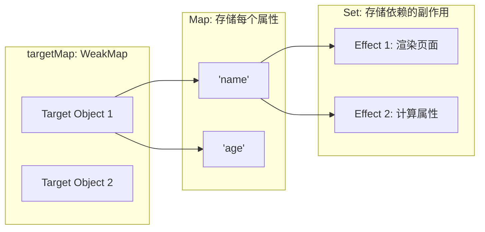
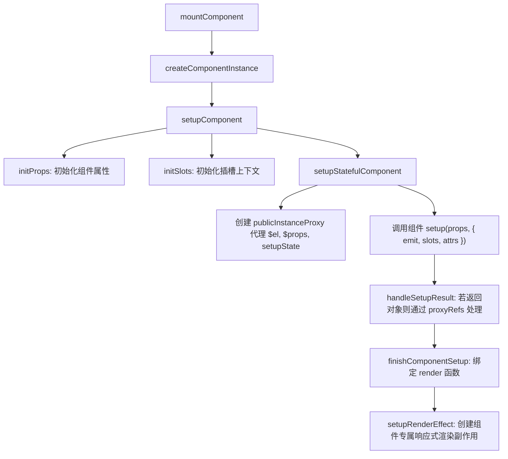
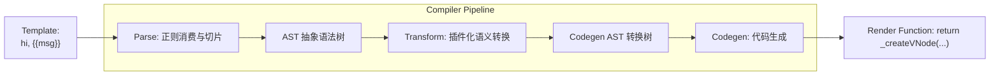

# 从零手写 Vue 3：mini-vue 核心设计思路与实现全景精读笔记

> 本笔记基于 `mini-vue-master` 源码全量拆解。剔除所有次要边界分支与平台兼容防御代码，带你从零推导 Vue 3 的**响应式内核（Reactivity）**、**运行时渲染器（Runtime）**与**模板编译器（Compiler）**的每一个工程细节与算法逻辑。

---

## 目录
1. [一、从零设计的思维主线：Vue 3 为什么这么构架？](#一一从零设计的思维主线vue-3-为什么这么构架)
2. [二、Reactivity 响应式系统逐层推导](#二reactivity-响应式系统逐层推导)
   - 2.1 依赖收集全景数据结构：`targetMap` 的三层拓扑
   - 2.2 `ReactiveEffect`：执行、收集门禁 (`shouldTrack`) 与 `cleanupEffect`
   - 2.3 `stop` 与 `onStop`：副作用精准终止机制
   - 2.4 `scheduler`：响应式派发与用户调度的完全解耦
   - 2.5 `ref` 的对象包装哲学与 `proxyRefs` 自动脱 ref 机制
   - 2.6 `computed` 的脏标记缓存与调度回写
3. [三、Runtime-Core 跨平台运行时与组件生命周期](#三runtime-core-跨平台运行时与组件生命周期)
   - 3.1 极致性能：`ShapeFlags` 二进制位运算节点类型判定
   - 3.2 组件实例与上下文初始化全流程（Props / Slots / Emits / PublicInstanceProxy）
   - 3.3 原型链借力：`provide` 与 `inject` 的就地继承与 O(1) 屏蔽
   - 3.4 异步调度器与微任务批处理去重：`nextTick` 与 `queueJob`
4. [四、虚拟 DOM 与 Diff 算法极限拆解（五步走）](#四虚拟-dom-与-diff-算法极限拆解五步走)
   - 4.1 第一步：头对头同步比对 (i)
   - 4.2 第二步：尾对尾同步比对 (e1, e2)
   - 4.3 第三步：新节点多于老节点（挂载 Mount）
   - 4.4 第四步：老节点多于新节点（卸载 Unmount）
   - 4.5 第五步：中间乱序处理与最长递增子序列（LIS）倒序移动（终极核心）
5. [五、Compiler 编译流水线：从模板到渲染函数](#五compiler-编译流水线从模板到渲染函数)
   - 5.1 Parse：有限状态机与字符串切片消费
   - 5.2 Transform：访问者模式与退出函数栈（后序遍历生成 CodegenNode）
   - 5.3 Codegen：代码生成与字符串递归拼接
6. [六、手写总结：Vue 3 各核心模块的依赖与数据流闭环](#六手写总结vue-3-各核心模块的依赖与数据流闭环)

---

## 一、从零设计的思维主线：Vue 3 为什么这么构架？

如果让你从零写一个前端 MVVM 框架，核心脉络必然经历以下三步：
1. **数据变了，我怎么知道？** $\rightarrow$ **响应式系统（Reactivity）**：用 Proxy 拦截读写，读取时“记下谁在用我”，修改时“通知他们更新”。
2. **知道数据变了，怎么只改该改的真实 DOM？** $\rightarrow$ **运行时渲染器（Runtime）**：将数据映射为轻量 JS 对象（VNode），新旧 VNode 通过 Diff 算法计算出最小 DOM 变更。
3. **开发者不想手写 VNode，想写 HTML 模板怎么办？** $\rightarrow$ **编译器（Compiler）**：将 HTML 模板编译解析为能返回 VNode 的 `render()` 函数。

---

## 二、Reactivity 响应式系统逐层推导

### 2.1 依赖收集全景数据结构：`targetMap` 的三层拓扑

Vue 3 使用三层嵌套映射维护“对象 $\rightarrow$ 属性 $\rightarrow$ 副作用”的关系：

```
targetMap: WeakMap<target, Map<key, Set<ReactiveEffect>>>
```



- **为什么外层必须是 `WeakMap`？**
  `WeakMap` 的键是弱引用。当外部没有任何地方引用这个目标对象时，垃圾回收器会自动回收该对象及其对应的依赖映射，**杜绝内存泄漏**。
- **为什么第二层是 `Map`？** 存储该对象下的所有属性名（`key`）。
- **为什么第三层是 `Set`（`dep`）？** 同一个属性可能被多个 `effect` 同时依赖，用 `Set` 自动去重。

---

### 2.2 `ReactiveEffect`：执行、收集门禁 (`shouldTrack`) 与 `cleanupEffect`

核心文件：`packages/reactivity/src/effect.ts`

```ts
let activeEffect = undefined; // 全局当前正在执行的 effect
let shouldTrack = false;     // 控制是否允许收集依赖的全局开关

export class ReactiveEffect {
  active = true;             // 是否处于活跃激活状态
  deps = [];                 // 记录所有包含当前 effect 的 dep 集合 (反向收集)
  public onStop?: () => void;

  constructor(public fn, public scheduler?) {}

  run() {
    // 已经 stop 停用的 effect：只执行用户函数，绝不收集依赖
    if (!this.active) {
      return this.fn();
    }

    // 开启门禁，记录当前全局活跃 effect
    shouldTrack = true;
    activeEffect = this;

    const result = this.fn();

    // 执行完毕，重置全局状态（类似调用栈弹出）
    shouldTrack = false;
    activeEffect = undefined;

    return result;
  }
}
```

#### 细节亮点：`cleanupEffect` 为什么至关重要？
考虑分支切换场景：
```js
const state = reactive({ ok: true, text: 'hello' });
effect(() => {
  app.innerHTML = state.ok ? state.text : 'nothing';
});
```
当 `state.ok = false` 之后，`state.text` 的变化就不应该再触发该 effect 重新执行！
因此每次 effect 执行前必须调用 `cleanupEffect`：
```ts
function cleanupEffect(effect) {
  effect.deps.forEach((dep) => {
    dep.delete(effect); // 从响应式属性的 Set 中彻底移除自己
  });
  effect.deps.length = 0;
}
```

---

### 2.3 `stop` 与 `onStop`：副作用精准终止机制
- **`stop(runner)`**：将当前 effect 从其所有关联的 `dep` 集合中删除（`cleanupEffect`），并将 `active = false`。
- **边界坑点**：如果用户代码执行 `state.foo++`（本质是 `state.foo = state.foo + 1`），会先触发 `get`（如果没锁住 `shouldTrack`，就会重新把刚 stop 的 effect 收集进去！）。Vue 通过 `shouldTrack = false` 的严格门禁彻底防范该问题。
- **`onStop` 回调**：允许用户在停止监听时注册清理逻辑。

---

### 2.4 `scheduler`：响应式派发与用户调度的完全解耦

`trigger()` 触发更新时的逻辑：
```ts
export function trigger(target, key) {
  const depsMap = targetMap.get(target);
  if (!depsMap) return;
  const dep = depsMap.get(key);

  for (const effect of dep) {
    if (effect.scheduler) {
      // 如果传了调度器，优先执行调度器，把控制权交给外部（比如组件异步更新队列）
      effect.scheduler();
    } else {
      // 默认同步执行 run
      effect.run();
    }
  }
}
```
**这一行解耦是整个 Vue 3 异步更新和 `computed` 赖以生存的基础！**

---

### 2.5 `ref` 的对象包装哲学与 `proxyRefs`

核心文件：`packages/reactivity/src/ref.ts`

- **为什么需要 `ref`？**
  ES6 Proxy 只能代理**对象（Object）**，无法拦截基本数据类型（`number`, `string`, `boolean`）。
- **`RefImpl` 实现**：通过定义拥有 `get value()` 和 `set value()` 访问器属性的类对象来拦截读取。
- **`proxyRefs`（模板自动脱 ref）**：
  在 Vue 模板中写 `{{ count }}` 不需要写 `{{ count.value }}`，就是因为组件 `setup()` 返回的对象被 `proxyRefs` 包装了一层：
  ```ts
  export function proxyRefs(objectWithRefs) {
    return new Proxy(objectWithRefs, {
      get(target, key) {
        return unref(Reflect.get(target, key)); // 自动 unref 脱壳
      },
      set(target, key, value) {
        if (isRef(target[key]) && !isRef(value)) {
          return (target[key].value = value);
        }
        return Reflect.set(target, key, value);
      }
    });
  }
  ```

---

### 2.6 `computed` 的脏标记缓存与调度回写

核心文件：`packages/reactivity/src/computed.ts`

```ts
class ComputedRefImpl {
  private _dirty: boolean = true; // 脏标记
  private _value: any;
  private _effect: ReactiveEffect;

  constructor(getter) {
    // 关键：传入自定义 scheduler！
    this._effect = new ReactiveEffect(getter, () => {
      // 当依赖的底层响应式数据改变时，不重新计算，只将脏标记置为 true！
      if (!this._dirty) {
        this._dirty = true;
      }
    });
  }

  get value() {
    if (this._dirty) {
      this._dirty = false;
      this._value = this._effect.run(); // 真正重新计算
    }
    return this._value; // 否则直接返回上一次缓存
  }
}
```

---

## 三、Runtime-Core 跨平台运行时与组件生命周期

### 3.1 极致性能：`ShapeFlags` 二进制位运算节点类型判定

核心文件：`packages/shared/src/shapeFlags.ts`

在运行时，系统需要频繁判断“这个 VNode 是不是组件？它的子节点是不是纯文本？是不是数组？”。如果用多重 `if-else` 或字符串比对，运行时开销很大。Vue 3 采用了**二进制位掩码（Bitmask）**：

```ts
export const enum ShapeFlags {
  ELEMENT = 1,                 // 00000001 (普通 DOM 元素)
  STATEFUL_COMPONENT = 1 << 2, // 00000100 (有状态组件)
  TEXT_CHILDREN = 1 << 3,      // 00001000 (子节点是文本)
  ARRAY_CHILDREN = 1 << 4,     // 00010000 (子节点是数组)
  SLOTS_CHILDREN = 1 << 5      // 00100000 (子节点是插槽)
}
```

- **组合标志位（按位或 `|`）**：
  `vnode.shapeFlag = ShapeFlags.STATEFUL_COMPONENT | ShapeFlags.ARRAY_CHILDREN;`
- **判定标志位（按位与 `&`）**：
  `if (vnode.shapeFlag & ShapeFlags.STATEFUL_COMPONENT) { /* 是组件 */ }`
  一条汇编级 CPU 指令即可完成类型判断，速度达到极致。

---

### 3.2 组件实例与上下文初始化全流程

当调用 `mountComponent()` 时，Vue 3 执行精密流水线：



#### 组件渲染核心：`setupRenderEffect`
```ts
function setupRenderEffect(instance, initialVNode, container) {
  // 每个组件实例都会创建一个属于自己的 ReactiveEffect！
  instance.update = effect(() => {
    if (!instance.isMounted) {
      // 首次挂载 (Mount)
      const subTree = (instance.subTree = instance.render.call(instance.proxy));
      patch(null, subTree, container, null, instance);
      initialVNode.el = subTree.el;
      instance.isMounted = true;
    } else {
      // 后续响应式触发的更新 (Patch)
      const nextTree = instance.render.call(instance.proxy);
      const prevTree = instance.subTree;
      instance.subTree = nextTree;
      patch(prevTree, nextTree, container, null, instance);
    }
  }, {
    // 异步批处理调度器
    scheduler() {
      queueJob(instance.update);
    }
  });
}
```

---

### 3.3 原型链借力：`provide` 与 `inject` 的就地继承

核心文件：`packages/runtime-core/src/apiInject.ts`

- **经典难题**：孙组件 `inject('theme')` 应该拿到最近父级的值；若父级没提供，则逐层向上找爷爷组件，且同一层级的兄弟组件不能互相污染。
- **Vue 的天才解法**：**直接利用 JavaScript 对象的原型链（`Object.create`）！**
```ts
export function provide(key, value) {
  const currentInstance = getCurrentInstance();
  if (currentInstance) {
    let { provides } = currentInstance;
    const parentProvides = currentInstance.parent?.provides;

    // 当第一次在当前组件调用 provide 时：
    // 将自己的 provides 对象的原型链指向父组件的 provides！
    if (parentProvides === provides) {
      provides = currentInstance.provides = Object.create(parentProvides);
    }

    provides[key] = value;
  }
}

export function inject(key, defaultValue) {
  const currentInstance = getCurrentInstance();
  if (currentInstance) {
    const parentProvides = currentInstance.parent?.provides;
    // 沿着原型链自动向上检索，O(1) 复杂度！
    if (key in parentProvides) {
      return parentProvides[key];
    }
    return defaultValue;
  }
}
```

---

### 3.4 异步调度器与微任务批处理去重：`nextTick` 与 `queueJob`

核心文件：`packages/runtime-core/src/scheduler.ts`

如果你在同一行代码里连续修改响应式变量 100 次：
```js
for (let i = 0; i < 100; i++) count.value++;
```
组件绝不能重新渲染 100 次。Vue 3 的异步批处理方案如下：
1. **去重入队**：维护一个待执行队列 `queue: any[]`，如果 `queue.includes(job)`，则直接忽略。
2. **微任务降频**：用 `isFlushPending` 锁门禁，只调用一次 `Promise.resolve().then(flushJobs)`。
3. **`nextTick(fn)`**：本质就是 `Promise.resolve().then(fn)`。因为 `flushJobs` 优先被推入微任务队列，所以用户在 `nextTick` 中读取 DOM 时，页面已经完成重绘！

---

## 四、虚拟 DOM 与 Diff 算法极限拆解（五步走）

核心文件：`packages/runtime-core/src/renderer.ts` 中的 `patchKeyedChildren`。

当新旧子节点都是数组，且都有 `key` 时，Vue 3 进入核心的双端预处理 + 最长递增子序列算法：

```
旧节点数组: c1 = [a, b, c, d, e, f, g]
新节点数组: c2 = [a, b, e, c, d, h, f, g]
```

### 第一步：左侧头对头同步（i 从 0 开始往右走）
- 比较 `c1[i]` 与 `c2[i]`，若 `isSameVNodeType` 为真，则直接递归 `patch` 复用，`i++`。
- 直到遇到不同节点跳出循环（在此例中比对完 `a`、`b`，指针停在 `c` 与 `e` 处，`i = 2`）。

### 第二步：右侧尾对尾同步（e1 与 e2 从右往左走）
- 比较 `c1[e1]` 与 `c2[e2]`，若相同则递归 `patch`，`e1--`，`e2--`。
- 直到遇到不同节点跳出循环（在此例中比对完 `g`、`f`）。

### 第三步：老节点全部比对完，新节点有剩余（新增挂载）
- 条件判定：`i > e1 && i <= e2`
- 说明旧节点已耗尽，`[i, e2]` 之间的所有节点全部是全新节点，循环调用 `patch(null, c2[i], container, anchor)` 执行插入。

### 第四步：新节点全部比对完，老节点有剩余（多余卸载）
- 条件判定：`i > e2 && i <= e1`
- 说明新节点不需要那么多，`[i, e1]` 之间的旧节点全部是废弃节点，循环调用 `hostRemove(c1[i].el)` 彻底销毁。

### 第五步：中间未知序列乱序比对（算法天花板）

此时两端相同节点均已就位，只剩下中间一段乱序部分：
- 旧中间：`[c, d, e]`
- 新中间：`[e, c, d, h]`

#### 5.1 建立新节点映射表 `keyToNewIndexMap`
遍历新中间节点，生成 `Map(key -> newIndex)`，后续只需 $O(1)$ 时间即可通过旧节点的 key 查到它在新列表的位置。

#### 5.2 构建新旧索引映射表 `newIndexToOldIndexMap`
创建一个固定长度的数组（长度等于新中间节点数量），**默认全部填充为 0**：
```ts
const toBePatched = e2 - s2 + 1;
const newIndexToOldIndexMap = new Array(toBePatched).fill(0);
```
- 遍历旧中间节点：
  - 如果新列表中找不到该节点 $\rightarrow$ 说明在新视图中被删了，调用 `hostRemove(prevChild.el)`。
  - 如果找到了，记录映射关系 `newIndexToOldIndexMap[newIndex - s2] = oldIndex + 1`（加 1 是为了防止老索引正好为 0 与初始未命中 0 混淆），并 `patch` 更新属性。
  - 同时用 `maxNewIndexSoFar` 检测是否有节点“逆序”，若逆序则标记 `moved = true`。

#### 5.3 求解最长递增子序列（LIS）
如果 `moved = true`，调用 `getSequence(newIndexToOldIndexMap)` 计算出**最长递增子序列的索引数组**。
> **核心意义**：处于最长递增子序列中的节点，**在 DOM 树中彼此的相对前后顺序根本没有变化，完全不需要移动真实 DOM！** 只有不在子序列里的节点才需要被移动。

#### 5.4 为什么必须倒序遍历执行移动？
```ts
for (let i = toBePatched - 1; i >= 0; i--) {
  const nextIndex = s2 + i;
  const nextChild = c2[nextIndex];
  // 锚点取当前节点后一个已确定位置的兄弟 DOM 元素！
  const anchor = nextIndex + 1 < l2 ? c2[nextIndex + 1].el : parentAnchor;

  if (newIndexToOldIndexMap[i] === 0) {
    // 全新节点，挂载
    patch(null, nextChild, container, anchor);
  } else if (moved) {
    if (j < 0 || i !== increasingNewIndexSequence[j]) {
      // 不在最长递增子序列中：需要移动真实 DOM
      hostInsert(nextChild.el, container, anchor);
    } else {
      // 命中最长递增子序列：纹丝不动！
      j--;
    }
  }
}
```
**致命细节**：原生 DOM 插入使用的是 `parentNode.insertBefore(newEl, anchor)`。**只有从后往前倒序插入，才能确保每一次插入时作为参考物的 `anchor` 已经是在 DOM 树中位置完全稳定的锚点！**

---

## 五、Compiler 编译流水线：从模板到渲染函数

核心目录：`packages/compiler-core/`



### 5.1 Parse：有限状态机与字符串切片消费
- **工作机制**：维护一个当前的游标和剩余模板字符串 `context.source`。
- **逐字符消费**：
  - 遇到 `{{` $\rightarrow$ 解析插值表达式 `parseInterpolation()`
  - 遇到 `<` 加字母 $\rightarrow$ 解析 Element 开始标签 `parseElement()`
  - 其余内容 $\rightarrow$ 解析为纯文本 `parseText()`
- 每次解析完一部分，调用 `advanceBy(context, length)` 截断字符串，继续向后扫描，构建出原始 AST 树。

### 5.2 Transform：访问者模式与退出函数栈（后序遍历生成 CodegenNode）
- 树的转换需要遵循“**先转换子节点，再根据转换好的子节点合成父节点代码结构**”。
- Vue 设计了极其优雅的**退出函数模式（Exit Functions）**：
  ```ts
  function traverseNode(node, context) {
    const exitFns: any = [];
    const transforms = context.nodeTransforms;
    for (let i = 0; i < transforms.length; i++) {
      const onExit = transforms[i](node, context);
      if (onExit) exitFns.push(onExit);
    }

    // 递归先处理全部子节点
    traverseChildren(node, context);

    // 逆序执行所有的退出函数
    let i = exitFns.length;
    while (i--) {
      exitFns[i]();
    }
  }
  ```

### 5.3 Codegen：代码生成与字符串拼接
- 接收带有 `codegenNode` 的根 AST 节点。
- 维护一个全局代码拼接上下文 `context.push(code)` 和缩进层级 `context.indent() / deindent()`。
- 生成导入的前置辅助函数：`const { toDisplayString: _toDisplayString, openBlock: _openBlock, createElementBlock: _createElementBlock } = Vue`。
- 拼接返回函数声明：`return function render(_ctx, _cache) { return ... }`。

---

## 六、手写总结：Vue 3 各核心模块的依赖与数据流闭环

```text
┌──────────────────────────────────────────────────────────────┐
│                        用户编写的模板与业务逻辑                 │
│                 <button @click="count++">{{ count }}</button> │
└──────────────────────────────┬───────────────────────────────┘
                               │
                编译期 (Compiler-Core / Dom)
                               │
                               ▼
            生成 render(_ctx) 函数 (包含 _toDisplayString)
                               │
                               ▼
┌──────────────────────────────────────────────────────────────┐
│                    运行时初始化 (Runtime-Core)                 │
│  createApp().mount() -> createComponentInstance -> setup()   │
└──────────────────────────────┬───────────────────────────────┘
                               │
               结合响应式系统 (Reactivity)
                               │
                               ▼
      new ReactiveEffect(componentUpdateFn, { scheduler })
                               │
            ┌──────────────────┴──────────────────┐
            ▼                                     ▼
      [读操作 get()]                        [写操作 set()]
            │                                     │
    track() 依赖收集                       trigger() 派发更新
            │                                     │
 targetMap 关联当前 effect              通过 scheduler 推入批处理队列
                                                  │
                                                  ▼
                                      微任务异步触发 flushJobs
                                                  │
                                                  ▼
                                      执行 patch(n1, n2)
                                      执行双端 + LIS Diff 算法
                                                  │
                                                  ▼
                                      最小代价操作真实 DOM
```

掌握了这份闭环图与以上每一个细节点，你不仅吃透了 `mini-vue` 的每一行代码，也真正打通了 Vue 3 官方全量源码的任督二脉！
