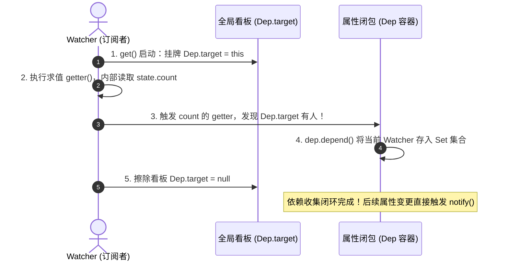
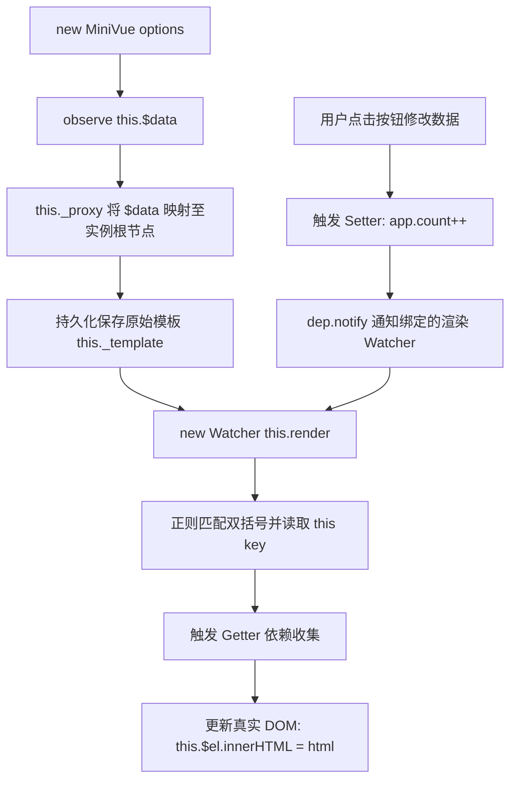

# Vue 响应式演进史与手写实战精髓笔记

> 本笔记完整提炼自 `study/mini-vue` 原生实战代码与核心注释。记录了从 **Vue 2 的 `Object.defineProperty`**、**7 个变异数组方法切片劫持**、**双 Dep 依赖架构**、**计算属性依赖传递栈**，到 **Vue 3 ES6 Proxy 中央集权制** 的全部设计思路与关键技术细节。

---

## 目录
1. [一、Step 1：属性拦截器的基础形态与深度递归 (reactive.js)](#一一step-1属性拦截器的基础形态与深度递归-reactivejs)
2. [二、Step 2：依赖收集“看板挂牌”机制与闭环 (watcher.js)](#二二step-2依赖收集看板挂牌机制与闭环-watcherjs)
3. [三、Step 3：Vue 2 数组劫持的“手术刀式”神操作 (array.js)](#三三step-3vue-2-数组劫持的手术刀式神操作-arrayjs)
   - 3.1 为什么 Vue 2 不通过下标拦截数组？
   - 3.2 7 个变异方法的原型链切片（AOP 拦截）
   - 3.3 源码核心机密：双 Dep 依赖体系与 `__ob__` 隐式桥梁
   - 3.4 新增元素（push/unshift/splice）的动态补漏观测
4. [四、Step 4：计算属性深度调优 —— 惰性求值与依赖传递 (computed.js)](#四四step-4计算属性深度调优--惰性求值与依赖传递-computedjs)
   - 4.1 惰性 Watcher (Lazy Watcher) 与脏标记 (Dirty Flag)
   - 4.2 嵌套 Watcher 靶向隔离：为什么必须有 `targetStack`？
   - 4.3 灵魂设计：计算属性的“依赖传递”（Dependency Passing）
5. [五、Step 5：Vue 3 Proxy 时代的升维革命 (vue3-proxy.js)](#五五step-5vue-3-proxy-时代的升维革命-vue3-proxyjs)
   - 5.1 数据污染终结：中央集权制 `targetMap` 三层拓扑
   - 5.2 惰性深度代理（按需递归）击碎首屏性能悬崖
   - 5.3 解决 Vue 2 三大历史硬伤（下标、length、deleteProperty）
   - 5.4 `Reflect` 与 `receiver` 的不可替代性
6. [六、Step 6：挂载真实 DOM 的极简运行时闭环 (index.html)](#六六step-6挂载真实-dom-的极简运行时闭环-indexhtml)
7. [七、Vue 响应式技术演进全局对比决策图](#七七vue-响应式技术演进全局对比决策图)

---

## 一、Step 1：属性拦截器的基础形态与深度递归 (reactive.js)

### 1.1 核心设计思想
利用 ES5 的 `Object.defineProperty(obj, key, descriptor)` 对对象现有属性的读取（`get`）和写入（`set`）进行切面拦截。

```js
function defineReactive(obj, key, val) {
  // 1. 递归观察嵌套子对象
  observe(val);

  Object.defineProperty(obj, key, {
    enumerable: true,
    configurable: true,
    get() {
      console.log(`🔍 属性 [${key}] 被读取了，当前值是:`, val);
      return val;
    },
    set(newVal) {
      if (newVal === val) return;
      console.log(`✍️ 属性 [${key}] 被修改了，旧值: [${val}], 新值: [${newVal}]`);
      val = newVal;
      // 2. 关键补漏：如果新赋予的值也是一个对象，必须递归将其响应式化！
      observe(newVal);
    }
  });
}
```

### 1.2 关键知识点与潜在陷阱
- **闭包持有 `val`**：`defineReactive` 函数中的形参 `val` 充当了该属性的底层真实存储槽，`get` 和 `set` 共享该闭包，避免了无限递归读取 `obj[key]`。
- **新值对象逃逸防范**：在 `set(newVal)` 中必须显式调用 `observe(newVal)`，否则后续给属性赋值的新对象将彻底失去响应式能力。
- **先天局限**：只能拦截**已存在的属性**，无法感知后天直接挂载的新属性（如 `obj.newProp = 1`）。

---

## 二、Step 2：依赖收集“看板挂牌”机制与闭环 (watcher.js)

### 2.1 尤雨溪的灵魂设计：数据变了，谁在用它，就去通知谁！
不能每次数据变更就无脑刷新整个页面。必须建立**属性（Dep）**与**视图更新任务（Watcher）**之间的精确映射。



### 2.2 核心代码实现
```js
class Dep {
  constructor() {
    this.subs = new Set(); // 存放使用该属性的所有 Watcher
  }
  depend() {
    if (Dep.target) this.subs.add(Dep.target);
  }
  notify() {
    this.subs.forEach(sub => sub.update());
  }
}
Dep.target = null; // 全局静态指针，用作挂牌看板

class Watcher {
  constructor(fn) {
    this.getter = fn;
    this.get(); // 实例化时立即执行一次，触发依赖收集
  }
  get() {
    Dep.target = this; // 挂牌
    this.getter();     // 触发相关属性的 getter，完成 dep.depend()
    Dep.target = null; // 摘牌
  }
  update() {
    this.get();        // 重新拉取最新值并重绘
  }
}
```

---

## 三、Step 3：Vue 2 数组劫持的“手术刀式”神操作 (array.js)

### 3.1 为什么 Vue 2 不能像对象一样拦截数组下标？
在规范层面，`Object.defineProperty` 是可以拦截数组下标的（如 `arr[0]`）。
**但尤雨溪团队在权衡后主动放弃了这条路线，原因在于物理性能灾难**：
- 如果一个数组有 10,000 项，或者定义了一个稀疏数组 `new Array(10000)`，要为每一个下标都执行一次 `defineReactive`，内存与初始化耗时将瞬间拉垮页面！

### 3.2 7 个变异方法的原型切片（AOP 面向切面拦截）
数组本身的数据变更，99% 是通过其原生方法引发的。Vue 2 锁定了能改变数组自身的 **7 个核心变异方法**：
`['push', 'pop', 'shift', 'unshift', 'splice', 'sort', 'reverse']`

```js
const originalProto = Array.prototype;
// 关键防污染：创建一个继承自原生 Array.prototype 的新对象
const arrayMethods = Object.create(originalProto);

const methodsToPatch = ['push', 'pop', 'shift', 'unshift', 'splice', 'sort', 'reverse'];

methodsToPatch.forEach(method => {
  const original = originalProto[method];
  Object.defineProperty(arrayMethods, method, {
    value: function mutator(...args) {
      // 1. 执行原生操作获取真实结果
      const result = original.apply(this, args);
      // 2. 拿到当前数组对应的 Observer 实例
      const ob = this.__ob__;

      // 3. 针对能新增元素的方法，把新加入的元素也递归进行响应式包装！
      let inserted;
      switch (method) {
        case 'push':
        case 'unshift':
          inserted = args;
          break;
        case 'splice':
          inserted = args.slice(2); // splice(start, deleteCount, ...items)
          break;
      }
      if (inserted) ob.observeArray(inserted);

      // 4. 通知依赖收集器：数组发生了改变！
      ob.dep.notify();

      return result;
    },
    enumerable: false,
    writable: true,
    configurable: true
  });
});
```

### 3.3 源码核心机密：双 Dep 依赖体系与 `__ob__` 隐式桥梁
这是很多开发者读 Vue 2 源码时最容易产生混淆的地方：**为什么每个数组或对象同时存在两个 Dep？**

```text
state = {
  hobbies: ['编程', '音乐']
}
```

1. **属性闭包中的 Dep (`dep in defineReactive`)**：
   - 挂在 `state.hobbies` 这个 key 的 getter/setter 闭包里。
   - **它的职责**：监听整块引用的替换（例如执行 `state.hobbies = ['新数组']` 时由它通知）。
2. **实例本身的 Dep (`childOb.dep in Observer`)**：
   - 挂在 `['编程', '音乐']` 这个数组对象内部的 `Observer` 实例上。
   - **它的职责**：监听数组**内部自身的方法调用（如 `push`、`splice`）**！
3. **`__ob__` 的不可枚举指针**：
   - 将当前 `Observer` 实例强行绑定在数据对象自身的 `__ob__` 属性上（`enumerable: false` 防止 JSON 序列化污染）。
   - 让变异函数内部能够顺着 `this.__ob__` 直接拿到它的 `ob.dep` 并调用 `ob.dep.notify()`！

---

## 四、Step 4：计算属性深度调优 —— 惰性求值与依赖传递 (computed.js)

### 4.1 惰性 Watcher (Lazy Watcher) 与脏标记 (Dirty Flag)
普通 Watcher 创建时立即执行，而计算属性必须做到两点：
1. **惰性执行（Lazy）**：不读取它，它绝对不执行用户传入的计算函数。
2. **缓存结果（Cache）**：依赖项没变时，重复读取必须秒回上次的缓存值。

```js
class Watcher {
  constructor(expOrFn, options = {}) {
    this.getter = expOrFn;
    this.lazy = !!options.lazy; // 计算属性专属标记
    this.dirty = this.lazy;     // 初始状态为 dirty = true，表示首次需要求值
    this.deps = [];

    // 若为普通 Watcher 立即求值；若为 lazy，暂不求值
    this.value = this.lazy ? undefined : this.get();
  }

  evaluate() {
    this.value = this.get();
    this.dirty = false; // 求值完毕，恢复为干净
  }

  update() {
    if (this.lazy) {
      // 依赖变化时不立刻算，只把脏标记设为 true，下次读取时再算！
      this.dirty = true;
    } else {
      this.get(); // 渲染 Watcher 直接重新渲染
    }
  }
}
```

### 4.2 嵌套 Watcher 靶向隔离：为什么必须有 `targetStack`？
在模板渲染过程中，必然发生 Watcher 的嵌套：
```html
<div>{{ fullName }}</div>  <!-- 外层是渲染 Watcher，内层是 fullName 的计算属性 Watcher -->
```
如果只有一个全局变量 `Dep.target`：
1. 渲染 Watcher 启动：`Dep.target = RenderWatcher`；
2. 渲染模板读取 `fullName`，进入计算属性内部：`Dep.target = ComputedWatcher`；
3. 计算属性求值完毕：执行 `Dep.target = null`！
4. **致命灾难**：外层渲染 Watcher 被意外清空，导致后续模板里的其它属性（如 `age`）无法再被渲染 Watcher 收集！

**解决方案：引入 Watcher 栈（`targetStack`）**：
```js
const targetStack = [];
function pushTarget(target) {
  targetStack.push(target);
  Dep.target = target;
}
function popTarget() {
  targetStack.pop();
  Dep.target = targetStack[targetStack.length - 1]; // 安全退回上一层 Watcher
}
```

### 4.3 灵魂设计：计算属性的“依赖传递”（Dependency Passing）
**经典面试题：修改 `firstName`，为什么页面视图会自动更新？**
- 视图模板只直接读取了 `fullName`，并没有直接使用 `firstName`。
- `firstName` 的 `dep` 理论上只收集了 `fullName` 的 `ComputedWatcher`。
- 当 `firstName` 改变时，`ComputedWatcher.update()` 只是把 `dirty = true`，谁去命令页面刷新？

**答案全在 `watcher.depend()` 的依赖跨级传递机制**：
```js
// 计算属性 getter
get() {
  const watcher = watchers[key];
  if (watcher) {
    if (watcher.dirty) {
      watcher.evaluate(); // 内部触发依赖收集，让 watcher.deps 记录 firstName 的 dep
    }
    // 关键：此时外层的 RenderWatcher 正在 targetStack 栈顶 (Dep.target)！
    if (Dep.target) {
      watcher.depend(); // 让计算属性把自己依赖的底层 dep，全部传递给外层的渲染 Watcher！
    }
    return watcher.value;
  }
}
```

---

## 五、Step 5：Vue 3 Proxy 时代的升维革命 (vue3-proxy.js)

### 5.1 数据污染终结：中央集权制 `targetMap`
Vue 2 将 `Dep` 和 `__ob__` 直接挂在数据对象本身，破坏了纯净数据结构。
Vue 3 彻底改为**中央集权字典**：

```
targetMap: WeakMap<target, Map<key, Set<effect>>>
```
- 外层使用 `WeakMap`，对象的生命周期完全由外部垃圾回收机制决定，**从根本上根治了内存泄漏**。

### 5.2 惰性深度代理（按需递归）击碎首屏性能悬崖
- **Vue 2 的通病**：在 `observe(data)` 初始化阶段，不管页面当前用不用，必须**一口气无脑深度递归遍历对象的所有层级属性**，在大型表单与深层嵌套数据下首屏极慢。
- **Vue 3 的神来之笔**：
  ```js
  get(target, key, receiver) {
    const result = Reflect.get(target, key, receiver);
    track(target, key);
    // 惰性深度代理：只有当真正读取到下一层属性时，才按需对其进行 reactive 包装！
    return typeof result === 'object' && result !== null ? reactive(result) : result;
  }
  ```
  未被用户访问的深层嵌套数据，**初始化开销直接归零！**

### 5.3 彻底解决 Vue 2 的三大历史硬伤
1. **直接通过下标修改数组**：`state.hobbies[0] = '新值'` $\rightarrow$ 完美触发 Proxy 的 `set`。
2. **直接修改数组 length**：`state.hobbies.length = 0` $\rightarrow$ Proxy 原生捕获 `length` 变更。
3. **删除属性**：`delete state.info.age` $\rightarrow$ 由 `deleteProperty` 陷阱直接拦截并派发更新。

### 5.4 `Reflect` 与 `receiver` 的不可替代性
在手写 Proxy 时，为什么必须写 `Reflect.get(target, key, receiver)` 而不能直接写 `target[key]`？
- **经典陷阱**：如果目标对象内部存在一个依赖其他属性的 getter：
  ```js
  const user = {
    firstName: '雨溪',
    lastName: '尤',
    get fullName() { return this.firstName + ' ' + this.lastName; }
  };
  ```
  如果直接用 `target[key]`，在访问 `fullName` 时，内部读取 `this.firstName` 的 `this` 将**直接指向原始 target**，导致 `firstName` 彻底逃逸出 Proxy 拦截，**无法收集依赖！**
- 传入 `receiver` 后，`Reflect.get` 强制将 getter 内部的 `this` 绑定为当前的 **Proxy 代理实例**，确保所有连带属性都能被正确追踪！

---

## 六、Step 6：挂载真实 DOM 的极简运行时闭环 (index.html)

在 `index.html` 中，所有上述理论通过一个 `MiniVue` 类直接驱动了真实的浏览器网页：



- **模板持久化（`_template`）**：必须暂存最初包含 `{{ key }}` 的字符串模板，否则初次渲染被替换成具体数值后，后续更新将再也找不到正则替换占位符！

---

## 七、Vue 响应式技术演进全局对比决策图

| 核心维度 | Vue 2.x 经典架构 (mini-vue 前半部) | Vue 3.x Proxy 现代架构 (mini-vue 后半部) |
| :--- | :--- | :--- |
| **底层拦截 API** | `Object.defineProperty` (属性级 getter/setter) | `Proxy` + `Reflect` (对象级切面全覆盖) |
| **依赖存储载体** | 数据对象属性闭包与 `__ob__` 内部挂载（侵入式） | 全局中央集权制 `WeakMap`（零数据污染、内存自回收） |
| **嵌套对象处理** | 初始化时一次性全量递归 `walk()`（首屏重） | 读取属性时按需动态代理 `reactive(result)`（极速轻量） |
| **数组处理策略** | 拦截 7 个变异方法 + 针对插入元素重设 `__ob__` | 原生 Proxy 下标与属性直接代理，零 Hack |
| **计算属性实现** | Lazy Watcher + 脏标记 + `watcher.depend()` 依赖传递 | ComputedRefImpl + 调度器 + `globalVersion` (3.5+) |
| **嵌套调用安全** | 维护 `targetStack` 栈式指针推进/退回 | `activeEffect` 调用栈 / 二进制位深度标记 |
| **属性动态增删** | 必须借用 `Vue.set()` 与 `Vue.delete()` API | 原生 `obj.newKey = val` 与 `delete obj.key` 原生捕获 |
