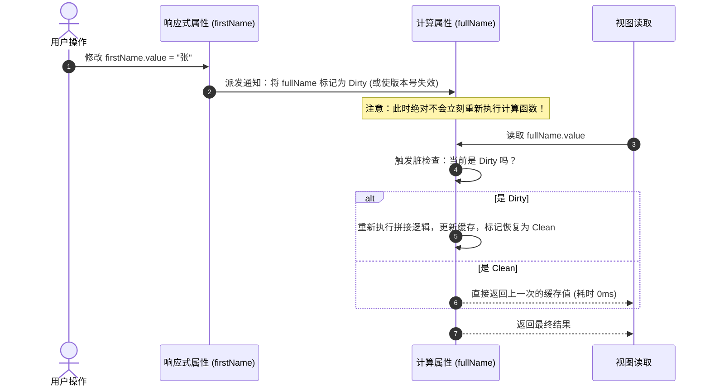

# Vue 3 核心架构与底层原理精读笔记

> 沉淀自 Vue 3 核心源码研读与现代前端架构演进剖析。涵盖 Monorepo 工程设计、Vue 3.5 响应式底层重构（双向链表与版本号机制）、计算属性脏检查演进以及源码断点调试实战。

---

## 目录
1. [一、Monorepo 架构与 Vue 3 模块拓扑](#一monorepo-架构与-vue-3-模块拓扑)
2. [二、Vue 3.5 响应式重构：双向链表 (Link) 与 50% 内存暴降之谜](#二vue-35-响应式重构双向链表-link-与-50-内存暴降之谜)
3. [三、版本号机制 (globalVersion) 与极速计算属性](#三版本号机制-globalversion-与极速计算属性)
4. [四、彻底搞懂“脏检查”（Dirty Checking）的前世今生](#四彻底搞懂脏检查dirty-checking的前世今生)
5. [五、Vue 3 vs Vue 2 核心底层技术演进对比](#五vue-3-vs-vue-2-核心底层技术演进对比)
6. [六、Vue 源码调试与核心断点下网指南](#六vue-源码调试与核心断点下网指南)

---

## 一、Monorepo 架构与 Vue 3 模块拓扑

### 1.1 什么是 Monorepo？
- **传统 Multi-repo（多仓模式）**：每个 npm 包维护一个独立的 Git 仓库（如 Vue 2 时代的 `vue`、`vuex`、`vue-router` 分散在不同仓库）。
- **Monorepo（单仓多包模式）**：**在同一个 Git 仓库内，集中管理多个功能解耦、可独立发布的子包（Sub-packages）**。

Vue 3 根目录使用 `pnpm-workspace.yaml` 将所有子包收纳在 `packages/` 目录下：

```text
vue-core/
├── pnpm-workspace.yaml
├── packages/
│   ├── reactivity/         # 独立响应式系统（无任何 DOM 依赖，可在 Node/小程序独立使用）
│   ├── runtime-core/       # 平台无关的运行时核心（虚拟 DOM、组件生命周期、Diff、调度器）
│   ├── runtime-dom/        # 浏览器 DOM 运行时适配（DOM 操作、事件、指令、Transition）
│   ├── compiler-core/      # 平台无关的编译器核心（AST 解析、Transform 变换、Codegen）
│   ├── compiler-dom/       # 浏览器专属编译规则（v-html、v-model、DOM 优化）
│   ├── compiler-sfc/       # 单文件组件解析器（<template>、<script setup>、<style>）
│   ├── shared/             # 所有包共用的内部基础工具类
│   └── vue/                # 面向最终开发者的全量入口包（整合 Runtime + Compiler）
```

### 1.2 为什么大型开源框架必选 Monorepo？

```mermaid
graph TD
    A[Monorepo 核心优势] --> B[原子化提交 Atomic Commits]
    A --> C[本地实时联调 Zero-link]
    A --> D[高度解耦 按需发包]
    A --> E[统一工程基建]

    B --> B1[一个 Commit/PR 同时修改编译器、运行时与单元测试，彻底杜绝多仓版本撕裂]
    C --> C1[使用 workspace:* 软链，改动 reactivity 立即在 runtime-dom 生效，免发布 beta 包]
    D --> D1[@vue/reactivity 可脱离 Web 独立用于 Node.js 数据流或游戏引擎]
    E --> E1[全仓库共享一套 TypeScript、Vitest、ESLint、Rollup 自动化打包流水线]
```

---

## 二、Vue 3.5 响应式重构：双向链表 (Link) 与 50% 内存暴降之谜

在 Vue 3.5 之前，Vue 的响应式虽然比 Vue 2 的 `Object.defineProperty` 快得多，但在超大型项目中依然面临严重的**内存开销**与 **垃圾回收（GC）掉帧** 瓶颈。

### 2.1 历史痛点（Vue 3.4 及以前的 Set 方案）
- **数据结构**：每一个响应式属性持有一个 `dep = new Set<ReactiveEffect>()`；每个 `effect` 也持有一个数组 `deps: Dep[]` 来做双向绑定。
- **痛点 1（内存昂贵）**：在 V8 引擎中，`Set` 内部包含哈希桶、容量扩容元数据，属于“重对象”。大型应用里有数十万个响应式字段，光是实例化 `new Set()` 就会吃掉大量内存。
- **痛点 2（GC 频繁导致掉帧）**：当组件执行条件渲染（`v-if` 分支变化）时，旧依赖需要逐一从 `Set` 中 `delete`，新依赖重新 `add`。产生巨量短命垃圾对象，频繁触发浏览器的 Stop-the-world GC。

### 2.2 破局之道：Vue 3.5 的十字双向链表（Link）

Vue 3.5 废弃了重型集合，设计了一个极度精简的连接节点对象 `Link`（代码位于 `packages/reactivity/src/dep.ts`）：

```ts
export class Link {
  version: number             // 记录当前绑定的 Dep 版本号
  
  // 纵向指针：连接同一个 Subscriber(Effect/Computed) 所依赖的所有 Dep
  nextDep?: Link
  prevDep?: Link
  
  // 横向指针：连接同一个 Dep 下所有正在监听它的 Subscribers
  nextSub?: Link
  prevSub?: Link

  constructor(public sub: Subscriber, public dep: Dep) {
    this.version = dep.version
  }
}
```

每个 `Link` 节点就像一个**空间十字路口**，同时挂接在两条双向链表上：

```
       Subscriber (Effect A)         Subscriber (Effect B)
                 │                             │
                 ▼                             ▼
Dep(name) ──► [ Link A1 ] ──nextSub──────► [ Link B1 ] ──► (广播更新链)
                 │
              nextDep
                 ▼
Dep(age)  ──► [ Link A2 ] ──nextSub──────► ...
                 │
           (依赖清理链)
```

### 2.3 内存降低 50% 的三大物理原因：
1. **纯 C++ 友好的内存对齐**：一个 `Link` 实例只有几个裸属性（指针），在 V8 虚拟机中能以最紧凑的隐藏类（Hidden Class）布局存储，完全杜绝了 `Set` 的底层哈希扩容开销。
2. **节点就地复用，零频繁垃圾回收**：当 Effect 重新执行时，顺着原有的链表复用已有 `Link` 节点，仅需更新版本号和指针，**不再销毁重建对象**。
3. **精准 O(1) 脱链**：当某个依赖不再需要时，通过双向链表节点的 `prev.next = next` 与 `next.prev = prev`，在常数时间内就地剪枝脱链。

---

## 三、版本号机制 (globalVersion) 与极速计算属性

Vue 3.5 配合链表架构，引入了全局与局部的版本标记系统：

```ts
// 全局响应式递增版本计数器
export let globalVersion = 0

// 任何响应式属性被修改、触发 trigger 时：
dep.version++
globalVersion++
```

### 3.1 计算属性（Computed）的极速通道（Fast Path）
- **过去**：计算属性要判断自己有没有变，往往需要递归向上遍历子依赖树，确认是否有底层属性脏了。
- **现在**：
  1. **全局 O(1) 瞬时短路**：当访问 `computed.value` 时，首先检查 `globalVersion` 是否发生过变化。如果全局版本号根本没动，说明**整个应用没有任何响应式数据被改写**，计算属性直接在 0 纳秒内返回上一次缓存！
  2. **局部高效整数比对**：若全局版本变化，只需沿着当前 Computed 的依赖链表对比 `link.version === dep.version`，纯整数比对，比查集合或者运行函数快几个数量级。

---

## 四、彻底搞懂“脏检查”（Dirty Checking）的前世今生

### 4.1 计算机本质：“脏（Dirty）”意味着什么？
在操作系统缓存、数据库脏读、图形学渲染管道中，“**脏（Dirty）**”统一指代：
> **“上游核心数据源已经发生了变更，但下游的派生数据、缓存结果或 UI 视图尚未同步，处于过时、不一致的状态。”**

所谓**脏检查**，就是去检测下游的状态是否处于“脏”态；若脏，则重新计算或重绘；若干净（Clean），则直接命中缓存。

### 4.2 前端历史上的两次“脏检查”范式对比

| 维度 | AngularJS 1.x 全局轮询脏检查 | Vue Computed 局部惰性脏标记（Dirty Flag） |
| :--- | :--- | :--- |
| **检测时机** | **被动全量轮询**：事件、网络请求或定时器结束时触发 `$digest` | **主动惰性检查**：只有当下游真正去读取该数据时才触发检查 |
| **检查范围** | **全量变量扫描**：递归把页面上挂载的数千个 Watcher 全部比对一遍新旧值 | **精确靶向**：只针对当前访问的特定计算属性及其依赖链 |
| **性能表现** | 变量超过 2000 个时产生肉眼可见的卡顿 | 极其轻量，未被读取的计算属性永远不消耗计算资源 |

### 4.3 Vue Computed 惰性求值闭环生命周期



---

## 五、Vue 3 vs Vue 2 核心底层技术演进对比

| 模块 | Vue 2.x (最终版 2.7) | Vue 3.x (当前 3.5) | 演进本质与收益 |
| :--- | :--- | :--- | :--- |
| **代码工程架构** | 单一主仓模式 | **pnpm Workspace Monorepo** | 模块彻底解耦，可按需提取 `@vue/reactivity` |
| **响应式拦截基石** | `Object.defineProperty` (getter/setter) | **ES6 Proxy + Reflect** | 支持原生拦截属性新增/删除、数组下标修改、Map/Set |
| **依赖存储结构** | 闭包 `Dep` 包含 `Watcher[]` | **双向链表 `Link` (3.5+)** | 彻底抛弃 `Set`，内存开销减少 50%，GC 压力大幅缓解 |
| **计算属性优化** | 基于 `dirty` 布尔值标记 | **`globalVersion` + 局部版本比对** | 全局无改动时 O(1) 瞬时返回，彻底消除多层 Computed 递归开销 |
| **Diff 算法机制** | 双端比对算法（头头、尾尾、头尾交叉） | **双端预处理 + 最长递增子序列 (LIS)** | 乱序节点比对时计算出**最少 DOM 移动步数**，DOM 操作开销降至极限 |
| **编译期静态优化** | 粗粒度静态根节点标记 (`staticRenderFns`) | **PatchFlags + Block Tree + 静态提升** | 靶向更新动态节点，跳过 90% 静态 DOM 的对比 |

---

## 六、Vue 源码调试与核心断点下网指南

### 6.1 黄金法则：如何命中带 TypeScript 源码的断点？
在仓库运行：
```bash
pnpm dev
```
构建脚本会在 `packages/vue/dist/` 下生成实时的 `vue.global.js` 和配套的 `.map` Source Map 文件。

### 6.2 快速启动测试页 (`debug.html`)
在根目录放置一个最简页面：
```html
<!DOCTYPE html>
<html>
<head>
  <script src="./packages/vue/dist/vue.global.js"></script>
</head>
<body>
  <div id="app">
    <button @click="count++">{{ count }}</button>
  </div>
  <script>
    const { createApp, ref, computed } = Vue
    createApp({
      setup() {
        const count = ref(0)
        const double = computed(() => count.value * 2)
        return { count, double }
      }
    }).mount('#app')
  </script>
</body>
</html>
```

### 6.3 读源码必打的 5 个关键断点位置

| 调试目标 | 目标源码文件 | 核心函数/断点位置 | 学习与观察重点 |
| :--- | :--- | :--- | :--- |
| **1. 代理对象生成** | `packages/reactivity/src/reactive.ts` | `createReactiveObject()` | 观察普通对象如何被 Proxy 包装，以及 `targetMap` 弱引用的初始化 |
| **2. 依赖收集入口** | `packages/reactivity/src/baseHandlers.ts` | `mutableHandlers.get()` | 变量被读取时，如何触发 `track()` 并通过 `Link` 节点串联双向链表 |
| **3. 派发更新广播** | `packages/reactivity/src/dep.ts` | `trigger()` 与 `startBatch()` | 变量写入时，版本号如何递增，并顺着 `nextSub` 指针批量通知副作用 |
| **4. 计算属性脏检查** | `packages/reactivity/src/computed.ts` | `ComputedRefImpl.get value()` | 亲眼观察 `globalVersion` 瞬时比对与链表版本检查的分支判断 |
| **5. 虚拟 DOM Diff** | `packages/runtime-core/src/renderer.ts` | `patchKeyedChildren()` | 观察数据变化时，最长递增子序列算法如何计算最小移动路径 |
