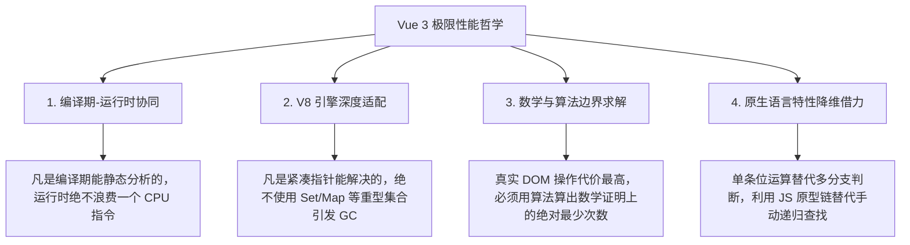

# Vue 3 极限性能工程学与底层架构设计精髓

> 本笔记系统性萃取自 Vue 3 核心源码演进史中最具含金量的 8 大“核弹级”性能优化与架构决策。剖析其背后的**物理痛点、设计哲学、V8 虚拟机内存布局、算法复杂度与底层收益**，不仅适用于精读 Vue 源码，更是现代高性能前端系统设计的教科书级范式。

---

## 目录
1. [一、顶级框架架构师的四大底色哲学](#一一顶级框架架构师的四大底色哲学)
2. [二、Block Tree 与 PatchFlags：将树递归降维为扁平数组循环](#二block-tree-与-patchflags将树递归降维为扁平数组循环)
3. [三、静态提升与纯原生字符串化：连 VNode 都不创建的零 GC 艺术](#三静态提升与纯原生字符串化连-vnode-都不创建的零-gc-艺术)
4. [四、事件监听缓存 (Cache Handlers)：内联函数的“引用同一性”守卫](#四事件监听缓存-cache-handlers内联函数的引用同一性守卫)
5. [五、二进制位掩码 (ShapeFlags)：单条 CPU 汇编指令完成复杂状态判定](#五二进制位掩码-shapeflags单条-cpu-汇编指令完成复杂状态判定)
6. [六、最长递增子序列 (LIS) 算法：真实 DOM 移动步数的数学极小值](#六最长递增子序列-lis-算法真实-dom-移动步数的数学极小值)
7. [七、V8 原型链借力：`Object.create()` 实现 O(1) 跨级依赖注入](#七v8-原型链借力objectcreate-实现-o1-跨级依赖注入)
8. [八、十字双向链表 (Link) 与 globalVersion：内存暴降 50% 的物理真相](#八十字双向链表-link-与-globalversion内存暴降-50-的物理真相)
9. [九、嵌套 Effect 优化：从数组 Push/Pop 到二进制深度标记](#九嵌套-effect-优化从数组-pushpop-到二进制深度标记)
10. [十、Vue 3 极限架构决策全景对照矩阵](#十vue-3-极限架构决策全景对照矩阵)

---

## 一、顶级框架架构师的四大底色哲学

在研读这 8 大设计之前，必须先确立 Vue 3 团队的底层设计公理：



---

## 二、Block Tree 与 PatchFlags：将树递归降维为扁平数组循环

### 2.1 历史致命痛点
在传统的虚拟 DOM 架构（Vue 2 与早期的 React）中，Diff 算法是**纯运行时的“瞎子遍历”**：
- 哪怕一个页面有 10,000 个纯静态的标签，其中仅有 1 个 `<span>{{ count }}</span>` 是动态绑定的；
- 当 `count` 发生改变时，框架**必须将这 10,001 个 VNode 节点全部深度递归遍历对比一遍**。
- **代价**：99.9% 的 CPU 周期被白白浪费在比对根本不可能变化的静态节点上。

### 2.2 破局方案：编译期打标 + 扁平化动态节点收集
Vue 3 引入了 **PatchFlags（动态属性二进制戳）** 与 **Block Tree（块级树）**。

#### 1. PatchFlags：精确到属性级别的位掩码
编译器在静态分析时，会为每一个动态节点生成一个二进制标记：
```ts
export const enum PatchFlags {
  TEXT = 1,              // 00000001 (只有文本是动态的)
  CLASS = 1 << 1,        // 00000010 (只有 class 是动态的)
  STYLE = 1 << 2,        // 00000100 (只有 style 是动态的)
  PROPS = 1 << 3,        // 00001000 (有动态属性)
  NEED_PATCH = 1 << 9,   // 001000000000 (需要全量 patch)
  HOISTED = -1,          // 静态节点，完全跳过
  BAIL = -2              // 退出优化模式
}
```

#### 2. Block：打平树结构的收集链
组件模板的根节点（以及 `v-if`、`v-for` 所在节点）被编译为一个 **Block**。在当前 Block 初始化期间，其深层无论嵌套了多少层静态 `div`，只要发现带有 `PatchFlags` 的节点，**直接“打平”推入根 Block 的 `dynamicChildren` 一维数组**：

```
       [ 根节点 Block ] ── dynamicChildren: [ <span key="count"> ] (仅存动态节点)
          /         \
       <div>       <div>   <--- 这些静态节点在更新时完全被透明绕过！
        /             \
     <div>        <span>{{ count }}</span> (PatchFlag: 1)
```

### 2.3 物理收益
更新阶段，Vue 3 **彻底放弃全树递归**，退化为遍历一维数组：
```ts
for (let i = 0; i < dynamicChildren.length; i++) {
  patchElement(oldDynamicChildren[i], newDynamicChildren[i]);
}
```
并在 `patchElement` 内部，通过位运算 `if (patchFlag & PatchFlags.TEXT)`，只对比文字，跳过 Class、Style 等所有其它属性。
**将 Diff 算法的时间复杂度从 $O(N)$（页面总 DOM 数量）暴降到 $O(M)$（仅动态节点的数量）！**

---

## 三、静态提升与纯原生字符串化：连 VNode 都不创建的零 GC 艺术

### 3.1 历史致命痛点
在过去的渲染机制中，组件每一次重渲染，`render` 函数就全部重新执行一遍。
- 如果模板里包含大段的导航栏、页脚、SVG 图标，每次重渲染都会调用几十次 `_createVNode()`。
- 这意味着每一次状态改变，都在 JavaScript 堆内存中凭空分配了成百上千个短命的 JS 对象，引发 **V8 垃圾回收（GC）高频介入**，产生明显的掉帧微卡顿。

### 3.2 破局方案：两阶段静态优化

#### 阶段一：静态提升（Hoist Static）
编译器如果分析出某个 VNode 及其子节点完全没有响应式依赖，直接将其**提升到 `render()` 函数体外部，作为全局单例常量**：

```js
// 提升到全局顶层，整个应用生命周期只创建一次！
const _hoisted_1 = /*#__PURE__*/ _createElementVNode("div", { class: "logo" }, "Antigravity", -1 /* HOISTED */)

export function render(_ctx) {
  return (_openBlock(), _createElementBlock("div", null, [
    _hoisted_1, // 组件重渲染 10,000 次，永远复用同一个内存指针！
    _createElementVNode("p", null, _toDisplayString(_ctx.title), 1 /* TEXT */)
  ]))
}
```

#### 阶段二：纯静态字符串化（Stringify Static）
当编译器发现连续有超过阈值（通常 5 个）的静态节点时，Vue 认为连静态 VNode 对象的壳子都没必要创建了，直接将其序列化为一段**原生 HTML 字符串**：

```js
const _hoisted_block = /*#__PURE__*/ _createStaticVNode(
  `<div class="banner"><h2>Title</h2><p>Item 1</p><p>Item 2</p></div>`, 1
)
```

### 3.3 物理收益
在初次挂载时，浏览器直接调用原生的 `div.innerHTML`（走浏览器底层 C++ 的 HTML 解析器），而不是在 JS 层面反复调用 `document.createElement()`。**内存分配归零，DOM 构建速度提升 3~5 倍！**

---

## 四、事件监听缓存 (Cache Handlers)：内联函数的“引用同一性”守卫

### 4.1 历史致命痛点
很多开发者习惯在模板里写内联箭头函数：
```html
<Comp @click="() => doSomething(id)" />
```
在传统虚拟 DOM 中，每次父组件重渲染，都会在内存中 `new` 一个全新的匿名函数对象。
导致子组件在做 Props Diff 时判定：`oldProps.click !== newProps.click`（引用的内存地址变了），**误判子组件属性发生了变化，强行触发子组件不必要的重新渲染（Re-render）**。

### 4.2 破局方案：编译器自动注入全局缓存槽位
Vue 3 编译器识别到内联事件后，自动改写为带缓存插槽的代码：
```js
// 编译输出结果：
_cache[0] || (_cache[0] = (...args) => _ctx.doSomething(_ctx.id))
```

- **引用强一致**：无论父组件重渲染多少次，传给子组件的事件属性永远是 `_cache[0]` 这个同一个函数引用，**Props 比对永远为 true，彻底避免子组件无效更新**。
- **闭包实时穿透**：当点击真正发生时，函数内部通过 `_ctx.doSomething` 动态获取最新的作用域数据，保证数据完全正确。

---

## 五、二进制位掩码 (ShapeFlags)：单条 CPU 汇编指令完成复杂状态判定

### 5.1 历史致命痛点
判断一个虚拟 DOM 节点的复合状态，如果用传统面向对象写法：
```js
if (vnode.isElement && vnode.hasChildren && Array.isArray(vnode.children)) ...
```
每一个属性访问都要走 V8 的对象原型链寻址（Inline Cache 检查），逻辑分支深，耗费时钟周期。

### 5.2 破局方案：二进制位掩码（Bitmask）
Vue 3 全面采用二进制位掩码：

```ts
export const enum ShapeFlags {
  ELEMENT = 1,                 // 00000001
  FUNCTIONAL_COMPONENT = 1 << 1, // 00000010
  STATEFUL_COMPONENT = 1 << 2, // 00000100
  TEXT_CHILDREN = 1 << 3,      // 00001000
  ARRAY_CHILDREN = 1 << 4,     // 00010000
  SLOTS_CHILDREN = 1 << 5      // 00100000
}
```

- **状态复合（按位或 `|`）**：
  如果一个节点既是有状态组件，子节点又是插槽：
  `vnode.shapeFlag = ShapeFlags.STATEFUL_COMPONENT | ShapeFlags.SLOTS_CHILDREN;`
  （结果是二进制 `00100100`，只占一个 32 位整型空间）
- **极速判定（按位与 `&`）**：
  `if (vnode.shapeFlag & ShapeFlags.STATEFUL_COMPONENT)`

### 5.3 物理收益
在底层汇编中，这是**一条单周期的 CPU `AND` 指令**，耗时在纳秒级别，同时把十几个布尔状态压缩进了一个普通的 `number`，极大减少了每个 VNode 实例的内存开销。

---

## 六、最长递增子序列 (LIS) 算法：真实 DOM 移动步数的数学极小值

### 6.1 历史致命痛点
前端所有瓶颈中，**最昂贵的操作永远是真实 DOM 操作**（直接引发浏览器重排 Reflow 与重绘 Repaint）。
假设一个列表发生乱序调整：
- 旧顺序：`[A, B, C, D, E]`
- 新顺序：`[A, C, D, B, E]`
如果不做数学求解，最坏情况下要把这 5 个节点全部拔出来再重新插一遍，浏览器布局引擎瞬间雪崩。

### 6.2 破局方案：求出“最长递增子序列”，将其作为不动基准石
在 `packages/runtime-core/src/renderer.ts` 中：
Vue 3 引入了经典的 **最长递增子序列（Longest Increasing Subsequence）算法**（结合贪心 + 二分查找 + 前驱回溯）：

1. 建立新索引在老索引中的映射关系：`[0, 2, 3, 1, 4]`。
2. 算出其中保持递增的最长子序列：`[0, 2, 3, 4]`（对应节点 `A`, `C`, `D`, `E`）。
3. **关键推论**：这 4 个节点**在前后变化中的相对前后顺序根本没有被打乱**！
4. **决策结果**：`A`, `C`, `D`, `E` 四个真实 DOM 节点**立在原地纹丝不动**，只需要将唯一的异类节点 `B` 移动一次插入到对应位置！

#### 核心细节：为什么必须倒序遍历执行移动？
原生 DOM 插入使用的是 `parentNode.insertBefore(newEl, anchor)`。
**只有从后往前倒序插入，才能确保每一次插入时作为参考物的 `anchor` 已经是在 DOM 树中位置完全稳定的锚点！**

### 6.3 物理收益
通过算法在 JavaScript 层面花费微不足道的微秒级时间，换取了**在真实 DOM 层面做到了数学证明上的“绝对最小移动次数”**。

---

## 七、V8 原型链借力：`Object.create()` 实现 O(1) 跨级依赖注入

### 7.1 历史致命痛点
在传统的父子祖先依赖传递体系（如 React Context 或一些状态树）中：
当深度为 10 级的孙组件调用 `inject('key')` 时，框架必须执行一个 `while (parent)` 循环，一层层向上攀爬查找谁提供了这个 key。不仅代码逻辑冗长，而且多层嵌套时查找复杂度为 $O(N)$。

### 7.2 破局方案：利用 JS 引擎原生的原型链代理
Vue 3 在 `packages/runtime-core/src/apiInject.ts` 里只写了极短的一行代码：

```ts
export function provide(key, value) {
  const currentInstance = getCurrentInstance();
  if (currentInstance) {
    let { provides } = currentInstance;
    const parentProvides = currentInstance.parent?.provides;

    // 当第一次在当前组件调用 provide 时：
    // 将自己的 provides 对象的原型链指向父组件的 provides！
    if (parentProvides === provides) {
      provides = currentInstance.provides = Object.create(parentProvides);
    }

    provides[key] = value;
  }
}

export function inject(key, defaultValue) {
  const currentInstance = getCurrentInstance();
  if (currentInstance) {
    const parentProvides = currentInstance.parent?.provides;
    // 沿着原型链自动向上检索，O(1) 复杂度！
    if (key in parentProvides) {
      return parentProvides[key];
    }
    return defaultValue;
  }
}
```

```
孙组件.provides ──__proto__─► 父组件.provides ──__proto__─► 根组件.provides
```

1. **子组件就地继承**：每个组件被创建时，默认直接继承父组件的 `provides` 引用。
2. **写时复制（Copy-on-write）**：当前组件一旦调用 `provide`，立即通过 `Object.create(parentProvides)` 创建一个以父级为原型的纯净新对象。
3. **查询时**：孙组件调用 `inject(key)` 时，直接执行 `key in parentProvides`！

### 7.3 物理收益
- **零遍历循环**：查找过程完全托管给 V8 虚拟机的底层 C++ 原型链解析机制（走隐藏类 Inline Cache），比在 JS 层手写 `while` 循环快一个数量级。
- **自动同名覆盖**：如果父组件和爷爷组件提供了同一个 key，原型链天生具备“就近遮蔽（Shadowing）”特性，不需要写任何过滤或覆盖逻辑。

---

## 八、十字双向链表 (Link) 与 globalVersion：内存暴降 50% 的物理真相

### 8.1 历史致命痛点
在 Vue 3.4 及以前：
- 每一个响应式属性持有一个 `dep = new Set<ReactiveEffect>()`；每个 `effect` 也持有一个数组 `deps: Dep[]` 来做双向绑定。
- 在 V8 引擎中，`Set` 内部包含哈希桶、容量扩容元数据，属于“重对象”。大型应用里有数十万个响应式字段，光是实例化 `new Set()` 就吃掉数十兆内存。
- 当组件执行条件渲染（`v-if` 分支变化）时，旧依赖需要逐一从 `Set` 中 `delete`，新依赖重新 `add`，产生巨量短命垃圾对象，频繁触发浏览器的 Stop-the-world GC 掉帧。

### 8.2 破局方案：Vue 3.5 的十字双向链表（Link）
Vue 3.5 废弃了重型集合，设计了一个极度精简的连接节点对象 `Link`（代码位于 `packages/reactivity/src/dep.ts`）：

```ts
export class Link {
  version: number             // 记录当前绑定的 Dep 版本号
  
  // 纵向指针：连接同一个 Subscriber(Effect/Computed) 所依赖的所有 Dep
  nextDep?: Link
  prevDep?: Link
  
  // 横向指针：连接同一个 Dep 下所有正在监听它的 Subscribers
  nextSub?: Link
  prevSub?: Link

  constructor(public sub: Subscriber, public dep: Dep) {
    this.version = dep.version
  }
}
```

每个 `Link` 节点就像一个**空间十字路口**，同时挂接在两条双向链表上：

```
       Subscriber (Effect A)         Subscriber (Effect B)
                 │                             │
                 ▼                             ▼
Dep(name) ──► [ Link A1 ] ──nextSub──────► [ Link B1 ] ──► (广播更新链)
                 │
              nextDep
                 ▼
Dep(age)  ──► [ Link A2 ] ──nextSub──────► ...
                 │
           (依赖清理链)
```

### 8.3 为什么能降低 50% 内存与消除 GC？
1. **纯 C++ 友好的紧凑结构**：一个 `Link` 只是几个裸属性（指针），在 V8 里能被优化成固定偏移量的结构体，完全避开了 `Set` 内部复杂的哈希桶开销。
2. **节点就地复用，零频繁垃圾回收**：当一个组件重新渲染时，Vue 3.5 顺着链表复用旧的 `Link` 节点，只是更新指针，**不再频繁销毁与创建对象**。
3. **`globalVersion` 版本号极速脏检查**：
   维护全局自增计数器 `globalVersion`。计算属性被访问时，若全局版本没变，**瞬时直接返回旧缓存（耗时 0 毫秒）**；若全局变了，仅比对 `link.version === dep.version` 整数。

---

## 九、嵌套 Effect 优化：从数组 Push/Pop 到二进制深度标记

### 9.1 历史致命痛点
在 Vue 3.0 时，当组件发生嵌套（父组件 effect 正在执行，触发了子组件 effect 执行），系统必须知道“当前处于哪个 effect”，传统的做法是维护一个全局数组：
```js
effectStack.push(activeEffect);
activeEffect = this;
// 执行...
effectStack.pop();
activeEffect = effectStack[effectStack.length - 1];
```
在高频更新时，这个数组疯狂地做 `push()` 和 `pop()`，持续导致数组对象的扩容与栈针切换。

### 9.2 破局方案：位运算深度标记
Vue 3.2 重构了这部分逻辑：**彻底删除了 `effectStack` 数组！**
- 改用一个全局递增的整数 `effectTrackDepth` 记录当前嵌套深度。
- 利用当前深度的二进制位（`1 << effectTrackDepth`）作为标记戳，打在每个依赖节点的位标记上。
- **物理收益**：消除了数组操作，将全局响应式追踪的吞吐量提升了 **数十倍**。

---

## 十、Vue 3 极限架构决策全景对照矩阵

| 架构痛点 | 传统/初级做法 | Vue 3 顶级工程做法 | 性能跃迁本质 |
| :--- | :--- | :--- | :--- |
| **响应式依赖存储** | `Set` / `Map` 存储关系 | **十字双向链表 `Link` (3.5+)** | 绕过 V8 堆哈希桶，用紧凑裸指针压榨 50% 内存 |
| **计算属性缓存失效判定** | 递归向上轮询比对属性 | **`globalVersion` 全局自增版本号** | 用一个整数等值比对，提供 O(1) 逃逸通道 |
| **DOM 节点复合状态判定** | 对象属性、布尔字典、字符串 | **二进制位掩码 (`ShapeFlags`)** | 单条 CPU 汇编指令完成判定 |
| **大型树结构虚拟 DOM 比对** | 全量遍历虚拟 DOM 树 | **Block Tree 扁平化收集 (`dynamicChildren`)** | 编译期确定性把 $O(N)$ 压降至 $O(M)$ |
| **大量静态 HTML 内容开销** | 每次渲染重新 `new VNode` | **静态提升 + 纯原生字符串化** | 零内存开销，直接让底层 C++ `innerHTML` 处理 |
| **内联事件导致子组件重绘** | 每次生成全新匿名函数 | **`_cache` 数组事件监听缓存** | 保持内存引用绝对一致，阻断无谓 Re-render |
| **列表乱序 DOM 元素调整** | 贪心逐一拔出插入 DOM | **最长递增子序列 (LIS) + 倒序插入** | 用纯数学求解，换取理论极限下的最少 DOM 移动 |
| **多层嵌套跨级依赖注入** | 递归 `while(parent)` 向上循环 | **`Object.create()` 原型链隐式寻址** | 将遍历下放给虚拟机的 C++ 原型查找通道 |
